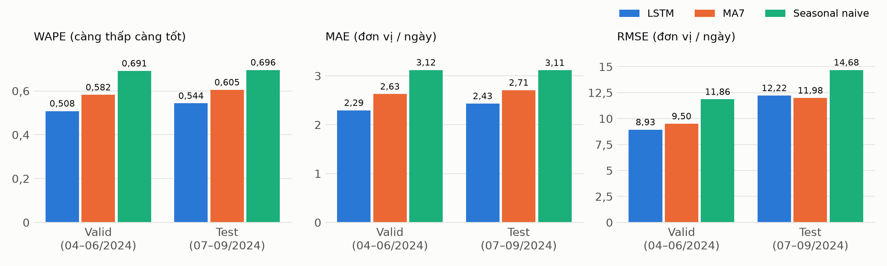
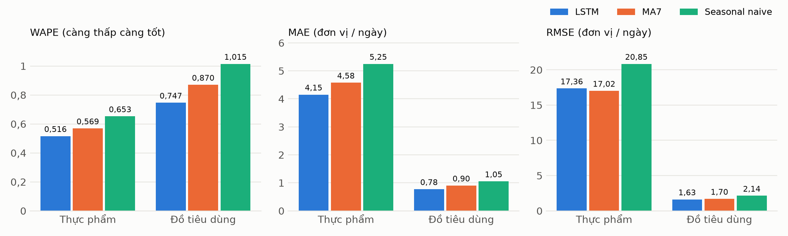
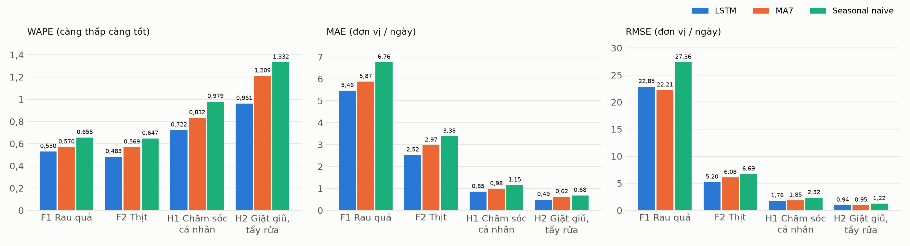

# III. Dataset

## A. Dataset Description

### 1. Nguồn dữ liệu

Bộ dữ liệu *Retail Sales Forecasting* trên Kaggle (`svizor/retail-sales-forecasting-data`): dữ liệu giao dịch thật của một chuỗi siêu thị có 4 cửa hàng. Tên ngành hàng viết bằng tiếng Nga, mã hàng đã được ẩn danh (chuỗi hash 12 ký tự). Bộ dữ liệu gồm 8 tệp CSV:

| Tệp | Số dòng | Cột chính | Nội dung | Sử dụng |
|---|---|---|---|---|
| `sales.csv` | 7.432.685 | `date`, `item_id`, `store_id`, `quantity`, `price_base`, `sum_total` | Bán tại quầy theo ngày × mã hàng × cửa hàng | Có: bảng nền, chứa biến mục tiêu |
| `discounts_history.csv` | 3.746.744 | giá trước / trong KM, `promo_type_code`, `doc_id`, `number_disc_day` | Lịch khuyến mãi (KM) theo chứng từ | Có: xác định ngày KM, đợt KM, mức giảm |
| `price_history.csv` | 698.626 | `price`, `code` | Lịch sử thay đổi giá | Có: giá thường ngày không KM |
| `catalog.csv` | 219.810 | `dept_name`, `class_name`, `subclass_name`, `item_type`, trọng lượng | Danh mục sản phẩm, 3 cấp phân loại | Có: nhóm hàng, thuộc tính sản phẩm |
| `stores.csv` | 4 | `division`, `format`, `city`, `area` | Thông tin cửa hàng | Có: đặc trưng tĩnh |
| `online.csv` | 1.123.412 | như `sales` | Bán online (chỉ cửa hàng 1 và 4) | Không: trùng khóa với `sales` ở 906.603 dòng, quan hệ chưa rõ |
| `markdowns.csv` | 8.979 | giá thường, giá xả, lượng | Giảm giá xả hàng | Không: chỉ 313 mã hàng |
| `actual_matrix.csv` | 35.202 | `item_id`, `date`, `store_id` | Danh sách mã hàng theo ngày | Không: quá thưa, ý nghĩa chưa rõ |

Bốn cửa hàng: CH1 (Format-1, City1, diện tích 1.500), CH2 (Format-6, City1, 210), CH3 (Format-7 express, City2, 109), CH4 (MaxiEuro, City3, 1.887). CH4 chỉ có dữ liệu từ 14/12/2023.

### 2. Phạm vi nghiên cứu và dữ liệu sau xử lý

Giai đoạn 28/08/2022 – 26/09/2024 (761 ngày), 4 nhóm hàng chọn theo cơ chế "dễ hỏng vs tích trữ được" (bài báo tham chiếu: Darbanian et al., 2025). Dataset không đủ mẫu hàng đông lạnh để tái lập thiết kế "tươi vs đông lạnh" của bài báo, nên đề tài so sánh Thực phẩm (food) với Đồ tiêu dùng (household):

| Nhóm | Ngành hàng | Mã hàng | Cặp mã hàng × cửa hàng | Dòng panel | Lượng bán TB / ngày | % ngày bán 0 |
|---|---|---|---|---|---|---|
| F1 Rau quả tươi | trái cây, rau củ | 613 | 1.437 | 381.968 | 8,61 | 42,8% |
| F2 Thịt tươi, thịt chế biến ướp lạnh | thịt, gia cầm, xúc xích (4 ngành) | 505 | 965 | 270.230 | 5,01 | 33,1% |
| H1 Chăm sóc cá nhân, giấy vệ sinh | 2 ngành | 826 | 1.342 | 431.835 | 1,16 | 56,6% |
| H2 Giặt giũ, tẩy rửa | 3 ngành | 222 | 319 | 113.294 | 0,52 | 67,6% |
| **Tổng** | 11 ngành | **2.166** | **4.063** | **1.197.327** | **4,34** | **48,0%** |

Dữ liệu sau xử lý gồm 3 bảng, mỗi bảng phục vụ một loại phân tích:

| Bảng | 1 dòng là | Kích thước | Dùng cho |
|---|---|---|---|
| `daily_panel.parquet` | mã hàng × cửa hàng × ngày | 1.197.327 × 56 cột | Mô hình dự báo ML/DL (LSTM, LightGBM…) |
| `episodes.csv` | 1 đợt KM thật (10.044) hoặc 1 đợt giả không KM (9.700) | 19.744 × 53 cột | Two-way ANOVA, t-test, chi-square, logistic, elasticity |
| `group_day.csv` | nhóm hàng × cửa hàng × ngày × trạng thái | 19.181 × 10 cột | Tái lập phân tích 6 nhãn của bài báo |

### 3. Biến mục tiêu và thống kê mô tả

Biến mục tiêu `quantity` (lượng bán ròng trong ngày, đơn vị cái hoặc kg nên có số lẻ): trung vị 0,63, trung bình 4,34, độ lệch chuẩn 17,0, P99 = 71,9, lớn nhất 987,8; 48% số ngày bán 0. Phân phối lệch phải mạnh và có nhiều số 0 (nhu cầu gián đoạn). Hai phía rất khác nhau: Thực phẩm trung bình 7,12 đơn vị/ngày (38,8% ngày bán 0), Đồ tiêu dùng 1,02 (58,9%).

Về khuyến mãi, 12,4% số dòng là ngày KM có giảm giá, 2,5% là KM không giảm giá, 85,1% không KM. Mức giảm (`depth`) trong ngày KM: trung vị 23,1%, P5 = 7,4%, P95 = 44,0%. Lượng bán trung bình: ngày KM giảm giá 6,81, ngày không KM 3,78. Loại KM phổ biến nhất là mã 5 (117.012 dòng) và 6 (45.692). Theo tuần, thứ Sáu bán cao nhất (5,25) và thứ Hai thấp nhất (3,83). 24,6% số dòng thuộc giai đoạn COVID-19 (PHEIC, đến 05/05/2023).

### 4. Các nhóm biến của `daily_panel`

Các cột của panel được chia thành các nhóm sau:

| Nhóm | Biến | Ghi chú |
|---|---|---|
| Khóa | `date`, `item_id`, `store_id`, `group4`, `category`, `dept_name`, `class_name`, `subclass_name` | |
| Mục tiêu | `quantity` | Ngày không có dòng bán = 0 (chỉ với cặp bán đều) |
| Lịch | `dow`, `day_of_month`, `week`, `month`, `is_weekend`, `is_holiday`, `holiday_status`, `days_to_holiday`, `days_after_holiday`, `ny_break`, `pheic`, `store4_period` | Biết trước |
| KM đã lên kế hoạch | `promo_status`, `depth`, `promo_type`, `day_in_promo`, `days_to_promo_end`, `promo_duration`, `days_since_last_promo` | Biết trước (cửa hàng tự lên lịch) |
| Giá | `regular_price`, `price`, `price_ratio` | Biết trước |
| Lịch sử bán | `lag_7`, `lag_14`, `lag_28`, `roll_mean_7`, `roll_mean_28`, `roll_std_28` | Chỉ dùng quá khứ (dịch ≥ 7 ngày) |
| Tĩnh | `item_type`, `weight_volume`, `weight_netto` (+ cờ thiếu), `division`, `format`, `city`, `area` | |
| Nhãn phân tích (không làm feature) | `revenue`, `qty_norm`, `phase`, `status6` | `revenue`, `qty_norm` chứa thông tin của biến mục tiêu |
| Chia dữ liệu | `split` | train / valid / test |

## B. Data Preprocessing

Dữ liệu gốc trong `dataset/` không bị sửa; toàn bộ pipeline nằm trong `src/prepare_data.py` (chạy khoảng 2 phút, seed = 42). Pipeline gồm 6 giai đoạn:

```
8 CSV thô → [A] Làm sạch → [B] Chọn phạm vi
          → [C] Chọn cặp bán đều, điền 0, gán nhãn
          → [D] Dựng đợt KM + đợt giả → [F] Tạo feature
          → [S] Chia train / valid / test
          → daily_panel.parquet · episodes.csv · group_day.csv
```

### 1. Làm sạch (giai đoạn A)

| Bước | Bảng | Quy tắc | Số dòng bị loại | Lý do |
|---|---|---|---|---|
| A1 | tất cả | Bỏ cột chỉ mục `Unnamed: 0` | | Do xuất CSV sinh ra |
| A2 | sales | `quantity`, `sum_total` hoặc `price_base` ≤ 0 | 9.204 | Trả hàng, hủy, dòng rỗng |
| A3 | sales | \|`sum_total` − `quantity` × `price_base`\| > 1 | 3.075 | Các trường tiền mâu thuẫn |
| A4 | discounts | Ngày sau 26/09/2024 | 314.913 | Lịch KM kéo dài tới 2045, ngoài kỳ bán |
| A5 | discounts | Giá trước KM ≤ 0 hoặc giá KM > giá trước KM | 42.306 | Không tính được mức giảm |
| A6–A7 | price_history | Dòng trùng; `price` ≤ 0 (gồm `code` 9999999999) | 18.641 + 60.421 | Bản ghi lặp, không phải giá bán |

Hai việc cố ý không làm: (1) không lọc ngoại lệ bằng IQR/z-score, vì sẽ xóa luôn đỉnh doanh số ngày KM và ngày lễ, vốn là đối tượng nghiên cứu; (2) không bỏ giai đoạn COVID (sẽ mất 25% dữ liệu), thay vào đó thêm cờ `pheic`.

### 2. Chọn phạm vi và chọn cặp bán đều (giai đoạn B, C)

Chỉ giữ mã hàng có trong catalog và thuộc 11 ngành hàng của 4 nhóm; các ngành này đều KM thường xuyên (≥ 100 đợt và ≥ 20% số mã hàng từng được KM). Catalog còn 21.543 mã hàng, sales còn 745.332 dòng. Bỏ 3 ngày cửa hàng hoạt động bất thường (CH3: 16/10/2022 đóng cửa, 22/10/2022 chỉ 10% lượng dòng thường ngày; CH4: 13/12/2023, ngày đầu xuất hiện). Chỉ dùng kênh cửa hàng (`sales`).

`sales.csv` không ghi dòng cho ngày không bán. Mật độ bán của mỗi cặp = số ngày có bán / số ngày từ lần bán đầu đến lần bán cuối. Giữ 4.063 cặp có mật độ ≥ 0,2 (loại 3.994 cặp, tương ứng 122.115 dòng). Với cặp được giữ, mọi ngày trong khoảng hoạt động mà không có dòng bán được gán `quantity = 0`; ngoài khoảng đó là "không có dữ liệu" (không phải 0). Sau đó gán nhãn theo ngày: `promo_status` (1 = KM có giảm giá, lấy mức giảm sâu nhất nếu trùng chứng từ; 0 = không KM; NaN = KM không giảm giá), `holiday_status` (−1 / 0 / 1 quanh Tết Dương lịch, 23/02, 08/03 theo lịch Nga; đây là giả thuyết suy từ dữ liệu), 6 nhãn `status6` như bài báo, và giai đoạn `phase` (1–3 ngày trước, trong, 1–3 và 4–7 ngày sau KM).

### 3. Dựng đợt KM và đợt giả (giai đoạn D)

Gộp các chứng từ KM chồng lấn hoặc liền kề của cùng cặp thành 16.163 đợt. Loại đợt không giảm giá (2.685), đợt có cửa sổ [3 ngày trước, 7 ngày sau] vượt kỳ dữ liệu hoặc chạm ngày không có dữ liệu (922 + 1.302), và đợt có KM khác trong cửa sổ (1.210), còn 10.044 đợt. Thêm 9.700 đợt giả dài 14 ngày, không có ngày KM nào, làm nhóm đối chứng: lượng bán vẫn có thể giảm sau một khoảng thời gian ngay cả khi không KM (hồi quy về trung bình), nên chỉ so "sau" với "trước" sẽ phóng đại hiệu ứng KM.

### 4. Tạo feature, chia dữ liệu và kiểm tra (giai đoạn F, S)

Feature lịch sử bán được dịch ≥ 7 ngày nên chỉ dùng quá khứ. Bỏ khỏi feature các cột rò rỉ biến mục tiêu (`revenue`, `qty_norm`, `price_base` của sales). Chia theo thời gian, không xáo trộn:

| Tập | Thời gian | Số dòng | Vai trò |
|---|---|---|---|
| train | 28/08/2022 – 31/03/2024 | 814.951 | Học tham số mô hình |
| valid | 01/04 – 30/06/2024 | 204.663 | Chọn siêu tham số, dừng sớm |
| test | 01/07 – 26/09/2024 | 177.713 | Đánh giá một lần duy nhất |

Việc chia chỉ áp dụng cho ML/DL; `episodes.csv` và `group_day.csv` dùng toàn bộ cho kiểm định thống kê. Mọi phép chuẩn hóa / điền thiếu cho mô hình chỉ học từ tập train.

Sau xử lý, `quantity` không có ô trống; bảng 6 nhãn có ô nhỏ nhất 50 quan sát (≥ 30); nhóm lớn nhất / nhỏ nhất về số đợt KM ≈ 2 lần (không cắt bớt nhóm lớn). Tỷ lệ thiếu còn lại: `regular_price` 10,2% (mã hàng chưa từng có giá/KM), `lag_28` 8,3% (đầu chuỗi), `days_since_last_promo` 33,6% (chưa từng KM). Mô hình cây tự xử lý giá trị thiếu; với LSTM, các giá trị này được điền và gắn cờ thiếu.

---


# IV. Chi tiết mô hình: LSTM encoder–decoder

Một mô hình toàn cục dự báo `quantity` cho 7 ngày tới, dùng chung cho cả 4.063 cặp mã hàng × cửa hàng. Encoder đọc $L$ ngày quá khứ: log-lượng bán, cờ có dữ liệu, feature KM, giá và lịch. Decoder chỉ nhận các feature biết trước của 7 ngày tới: KM đã lên lịch, giá, lịch và lễ. Thuộc tính tĩnh (cửa hàng, nhóm hàng, ngành hàng, class, format) đi qua embedding. Cấu hình chọn bằng Manual Grid Search là $L = 56$ ngày, 128 đơn vị ẩn, learning rate 0,002 (221.533 tham số). Trên tập test, WAPE của LSTM là 0,544, so với 0,605 của MA7 và 0,696 của seasonal naive. Mã nguồn: `src/train_lstm.py` và `src/lstm_hypothesis_tests.py`.

## 1. Công thức (Formulas)

### 1.1. Tế bào LSTM

Với đầu vào $\mathbf{x}_\tau$, trạng thái ẩn $\mathbf{h}$ và trạng thái nhớ $\mathbf{c}$ ($\sigma$ là hàm sigmoid, $\odot$ là phép nhân từng phần tử):

$$\mathbf{i}_\tau = \sigma(W_i\mathbf{x}_\tau + U_i\mathbf{h}_{\tau-1} + \mathbf{b}_i),\quad \mathbf{f}_\tau = \sigma(W_f\mathbf{x}_\tau + U_f\mathbf{h}_{\tau-1} + \mathbf{b}_f),\quad \mathbf{o}_\tau = \sigma(W_o\mathbf{x}_\tau + U_o\mathbf{h}_{\tau-1} + \mathbf{b}_o)$$

$$\mathbf{g}_\tau = \tanh(W_g\mathbf{x}_\tau + U_g\mathbf{h}_{\tau-1} + \mathbf{b}_g),\qquad \mathbf{c}_\tau = \mathbf{f}_\tau \odot \mathbf{c}_{\tau-1} + \mathbf{i}_\tau \odot \mathbf{g}_\tau,\qquad \mathbf{h}_\tau = \mathbf{o}_\tau \odot \tanh(\mathbf{c}_\tau)$$

Cổng quên $\mathbf{f}$ cho phép mô hình nhớ thông tin xa, ví dụ một đợt KM cách đây vài tuần.

### 1.2. Đầu ra dự báo

Trạng thái cuối của encoder là trạng thái đầu của decoder. Đầu ra bằng mức nền của chuỗi cộng một độ lệch $z$ do MLP học từ đầu ra decoder $\mathbf{s}_{t+j}$ và feature của chính ngày dự báo ($m$ là cờ có dữ liệu):

$$\ell_{i,t} = \frac{\sum_{\tau=t-L+1}^{t} m_{i,\tau}\ln(1+q_{i,\tau})}{\max(1,\ \sum_\tau m_{i,\tau})},\qquad \hat q_{i,t+j} = \max\left(0,\ e^{\,\ell_{i,t} + z_{i,t+j}} - 1\right),\quad j = 1,\dots,7$$

Nhờ có mức nền, mạng chỉ cần học "ngày này cao hay thấp hơn bình thường bao nhiêu", nên một mô hình dùng chung được cho cả chuỗi bán ít lẫn chuỗi bán nhiều.

### 1.3. Hàm mất mát, chỉ số đánh giá và tuning

Hàm mất mát và các chỉ số đánh giá chỉ tính tổng trên các ngày có dữ liệu:

$$\mathcal{L} = \frac{\sum m\,|\hat q - q|}{\sum m},\qquad \text{WAPE} = \frac{\sum|\hat q - q|}{\sum q},\qquad \text{Bias} = \frac{\sum(\hat q - q)}{\sum q}$$

Vì mẫu số của WAPE cố định, cực tiểu MAE cũng chính là cực tiểu WAPE.

Cấu hình được chọn theo $\theta^* = \arg\min_{\theta \in \mathcal{G}} \text{WAPE}_{\text{valid}}(\theta)$, với lưới $\mathcal{G} = \{28, 56\} \times \{64, 128\} \times \{0{,}001;\ 0{,}002\}$ (lookback × số đơn vị ẩn × learning rate). Mỗi cấu hình được huấn luyện bằng Adam (batch 1.024) và dừng sớm khi WAPE valid không giảm thêm $10^{-4}$ trong 4 epoch liên tiếp (tối đa 40 epoch), rồi khôi phục trọng số của epoch tốt nhất.

## 2. Giả định (Assumptions)

LSTM là mô hình phi tham số nên không giả định quan hệ tuyến tính, phần dư chuẩn hay chuỗi dừng. Các giả định thực sự cần là:

| Giả định | Cách đảm bảo / kiểm tra | Kết quả |
|---|---|---|
| Quy luật ổn định theo thời gian | So WAPE train → valid → test | 0,477 → 0,508 → 0,544: thỏa một phần |
| Không rò rỉ thông tin tương lai | Decoder chỉ nhận feature biết trước; bỏ `revenue`, `qty_norm`; chuẩn hóa chỉ học từ train; chia theo thời gian | Thỏa theo thiết kế |
| $L$ ngày quá khứ đủ thông tin | Thử $L \in \{28, 56\}$ | $L = 56$ tốt hơn một chút |
| Các chuỗi chia sẻ động lực chung | Dùng mức nền + embedding; so sánh theo cửa hàng và nhóm hàng | LSTM tốt nhất ở cả 4 cửa hàng và 4 nhóm |
| Ngày không có dữ liệu khác ngày bán 0 | Dùng mặt nạ $m$ trong loss và khi đánh giá | Thỏa theo thiết kế |
| MAE cho dự báo trung vị, không phải trung bình | Kiểm định bias (H4) | Dự báo thấp hơn thực tế 15,6% |

Phần dư rất xa phân phối chuẩn (skewness −23,6; kurtosis 1.193; Jarque–Bera $p \approx 0$), nên mục 3 dùng kiểm định phi tham số hoặc sai số chuẩn vững HAC thay cho t-test cổ điển.

## 3. Kiểm định giả thuyết (Hypothesis tests)

Các kiểm định chạy trên tập test (01/07 – 26/09/2024, 88 ngày, 2.530 cặp), α = 0,05. Diebold–Mariano (DM): sai số tuyệt đối được gộp theo ngày, có hiệu chỉnh mẫu nhỏ Harvey–Leybourne–Newbold ($h = 7$):

$$d_t = \sum_i|e^{\text{LSTM}}_{i,t}| - \sum_i|e^{\text{base}}_{i,t}|,\qquad DM = \frac{\bar d}{\sqrt{\hat V_{\text{HAC}}/n}}$$
 Khoảng tin cậy 95% lấy bằng block bootstrap theo ngày. Wilcoxon signed-rank so MAE của từng cặp giữa hai mô hình. Kiểm định bias dùng t-test với sai số chuẩn HAC. Ljung–Box kiểm tra tự tương quan của sai số theo ngày.

| Giả thuyết ($H_1$) | Kiểm định | Kết quả | Kết luận |
|---|---|---|---|
| H1. LSTM chính xác hơn MA7 | DM, một phía | ΔWAPE = −0,061 [−0,073; −0,054]; $DM^*$ = −10,69; p = 7,9 × 10⁻¹⁸ | Bác bỏ $H_0$ |
| H1'. LSTM chính xác hơn seasonal naive | DM, một phía | ΔWAPE = −0,152 [−0,169; −0,137]; p = 1,3 × 10⁻³¹ | Bác bỏ $H_0$ |
| H2. LSTM tốt hơn ở cấp từng chuỗi | Wilcoxon, so với MA7 | 83,7% số cặp tốt hơn; rank-biserial r = 0,75; p < 10⁻³⁰⁰ | Bác bỏ $H_0$ |
| H3. Ưu thế giữ được theo nhóm hàng và giai đoạn KM | DM × 6, hiệu chỉnh BH | ΔWAPE từ −0,04 (trong KM) đến −0,29 (4–7 ngày sau KM); mọi $p_{BH}$ ≤ 0,015 | Bác bỏ $H_0$ |
| H4. Dự báo có chệch | t-test HAC | Bias = −15,6% (Thực phẩm −12,9%, Đồ tiêu dùng −36,1%); p = 1,8 × 10⁻²⁰ | Có chệch: dự báo thấp |
| H5. Sai số có tự tương quan | Ljung–Box | Q(7) = 39,9; p < 0,0001 | Có tự tương quan |

LSTM chính xác hơn các baseline một cách có ý nghĩa, ở cả cấp tổng thể lẫn từng chuỗi. Ưu thế lớn nhất là ngay sau KM: MA7 lấy lượng bán cao trong KM làm mức nền nên dự báo quá cao, còn LSTM có feature hậu KM. Đổi lại, LSTM dự báo thấp có hệ thống, nặng nhất ở Đồ tiêu dùng (hàng bán thưa, 57% số ngày bán 0), vì MAE kéo dự báo về trung vị. Mức chệch còn thay đổi theo thứ trong tuần (từ −12% đến −19%). Nếu dùng để đặt hàng, nên thử loss Poisson/Tweedie hoặc dự báo phân vị.

## 4. Source code và giải thích

Trích từ `src/train_lstm.py` (PyTorch); các dòng ghi log được lược bớt.

```python
class Seq2SeqLSTM(nn.Module):
    def __init__(self, n_enc, n_dec, hid=64, dropout=DROPOUT):
        super().__init__()
        self.embs = nn.ModuleList([nn.Embedding(c, k) for c, k in zip(CARDS, EMB_DIMS)])
        ne = sum(EMB_DIMS)
        self.enc = nn.LSTM(n_enc + ne, hid, batch_first=True)
        self.dec = nn.LSTM(n_dec + ne, hid, batch_first=True)
        self.drop = nn.Dropout(dropout)
        self.head = nn.Sequential(nn.Linear(hid + n_dec + ne, hid), nn.ReLU(), nn.Linear(hid, 1))

    def forward(self, enc, dec, st):
        emb = torch.cat([m(st[:, i]) for i, m in enumerate(self.embs)], -1)
        # mức nền: trung bình log1p(q) trên các ngày có dữ liệu (cột 0 = log1p(q), cột 1 = cờ)
        level = (enc[..., 0] * enc[..., 1]).sum(1) / enc[..., 1].sum(1).clamp(min=1)
        _, hc = self.enc(torch.cat([enc, emb[:, None].expand(-1, enc.size(1), -1)], -1))
        d_in = torch.cat([dec, emb[:, None].expand(-1, dec.size(1), -1)], -1)
        out, _ = self.dec(d_in, hc)
        z = self.head(torch.cat([self.drop(out), d_in], -1)).squeeze(-1)
        return level[:, None] + z                        # dự báo log1p(q)
```

- `embs`: embedding cho 5 thuộc tính tĩnh, ghép vào đầu vào ở mọi bước thời gian.
- `level` là mức nền $\ell_{i,t}$. `hc` là trạng thái $(\mathbf{h}, \mathbf{c})$ cuối của encoder, dùng làm trạng thái đầu của decoder.
- `head` nhận cả đầu ra decoder lẫn feature của ngày dự báo (`d_in`), nên KM và giá của ngày đó tác động trực tiếp lên dự báo $z$.

```python
def train_variant(L, hid, lr, tw, vw):
    model = Seq2SeqLSTM(2 + NPR + NCAL, NPR + NCAL, hid=hid).to(DEV)
    opt = torch.optim.Adam(model.parameters(), lr=lr)
    best, bad = np.inf, 0
    for ep in range(1, MAX_EPOCHS + 1):
        idx = rng.choice(len(tw[0]), WIN_PER_EPOCH, replace=False)
        for i in range(0, len(idx), BATCH):
            enc, dec, st, y, o = make_batch(tw[0][idx[i:i+BATCH]], tw[1][idx[i:i+BATCH]], L)
            q_hat = torch.expm1(model(enc, dec, st).clamp(-5, 9))
            loss = ((q_hat - torch.expm1(y)).abs() * o).sum() / o.sum().clamp(min=1)
            opt.zero_grad(); loss.backward(); opt.step()
        w = wape(*predict(model, vw[0], vw[1], L, I_VALID_END))   # WAPE trên hold-out valid
        if w < best - MIN_DELTA:
            best, bad = w, 0
            best_state = {k: v.clone() for k, v in model.state_dict().items()}
        else:
            bad += 1
            if bad >= PATIENCE:
                break
    model.load_state_dict(best_state)
    return model, best

for L, hid, lr in VARIANTS:                              # Manual Grid Search: 8 cấu hình
    m, w = train_variant(L, hid, lr, tw, vw)             # giữ cấu hình có WAPE valid nhỏ nhất
```

- Mỗi epoch lấy ngẫu nhiên 150.000 cửa sổ train. Loss là MAE có mặt nạ `o`, tính trên lượng gốc (`expm1`); `clamp` tránh tràn số khi lấy mũ.
- Sau mỗi epoch, đo WAPE trên tập valid để dừng sớm (`PATIENCE = 4`, `MIN_DELTA = 1e-4`), rồi nạp lại trọng số tốt nhất.
- Tập test không dùng trong vòng lặp này; nó chỉ được đánh giá một lần cho cấu hình được chọn.
- Đoạn trên là bản rút gọn: mã gốc còn có gradient clipping, `ReduceLROnPlateau` và ghi log.

Chạy lại: `python src/train_lstm.py` (khoảng 90 phút trên GPU T4), rồi `python src/lstm_hypothesis_tests.py` (vài giây).

# V. Kết quả chạy mô hình: so sánh MAE / RMSE / WAPE (LSTM)

LSTM được so sánh với hai baseline: MA7 (trung bình 7 ngày gần nhất) và seasonal naive (cùng thứ của tuần trước). Cả ba mô hình được đánh giá trên cùng các dòng dữ liệu, cùng cách chia khối tuần và tầm dự báo 1–7 ngày. Tập valid (04–06/2024) đã được dùng để chọn siêu tham số; tập test (07–09/2024) chỉ được đánh giá một lần. Kết quả được so sánh ở ba cấp: tổng thể, theo category (Thực phẩm / Đồ tiêu dùng) và theo group (F1, F2, H1, H2). Biểu đồ được tạo bởi `src/plot_metrics_comparison.py`, ảnh nằm trong `output/lstm/figures/`.

## 1. So sánh tổng thể

| Tập | Mô hình | WAPE | MAE | RMSE |
|---|---|---|---|---|
| Valid | **LSTM** | **0,508** | **2,29** | **8,93** |
| | MA7 | 0,582 | 2,63 | 9,50 |
| | Seasonal naive | 0,691 | 3,12 | 11,86 |
| Test | **LSTM** | **0,544** | **2,43** | 12,22 |
| | MA7 | 0,605 | 2,71 | **11,98** |
| | Seasonal naive | 0,696 | 3,11 | 14,68 |



- **WAPE, MAE:** LSTM thấp nhất ở cả valid và test; trên test WAPE giảm 10% so với MA7 và 22% so với seasonal naive, chênh lệch có ý nghĩa thống kê (Diebold–Mariano, mục IV.3).
- **RMSE:** trên test LSTM cao hơn MA7 một chút (12,22 so với 11,98) vì được huấn luyện bằng MAE nên hay dự báo thấp ở các ngày bán đột biến (chệch −15,6%).
- **Valid → test:** sai số cả ba mô hình đều tăng do test là 3 tháng hè xa dữ liệu train, nhưng thứ hạng theo WAPE và MAE không đổi.

## 2. So sánh theo category (nhóm hàng)

Bảng dưới tính trên tập test (07–09/2024), tách theo nhóm hàng; lượng bán trung bình là tổng lượng bán chia số dòng.

| Nhóm hàng | Số dòng | Lượng bán TB/ngày | Mô hình | WAPE | MAE | RMSE |
|---|---|---|---|---|---|---|
| Thực phẩm | 87.185 | 8,04 | **LSTM** | **0,516** | **4,15** | 17,36 |
| | | | MA7 | 0,569 | 4,58 | **17,02** |
| | | | Seasonal naive | 0,653 | 5,25 | 20,85 |
| Đồ tiêu dùng | 90.528 | 1,04 | **LSTM** | **0,747** | **0,78** | **1,63** |
| | | | MA7 | 0,870 | 0,90 | 1,70 |
| | | | Seasonal naive | 1,015 | 1,05 | 2,14 |



- **Độ khó giữa hai nhóm:** Đồ tiêu dùng có WAPE cao hơn hẳn (0,75–1,02 so với 0,52–0,65) vì bán thưa, khoảng 1 đơn vị/ngày; MAE, RMSE của nhóm này nhỏ chỉ do lượng bán nhỏ, nên so sánh giữa nhóm phải dùng WAPE.
- **Thực phẩm:** LSTM giảm WAPE 9% so với MA7 (0,516 so với 0,569), nhưng RMSE vẫn cao hơn MA7 một chút vì dự báo thấp ở các ngày bán rất cao.
- **Đồ tiêu dùng:** ưu thế của LSTM lớn nhất, WAPE thấp hơn MA7 14% (0,747 so với 0,870) và tốt nhất ở cả ba chỉ số.

## 3. So sánh theo nhóm con (group)

Mỗi category được chia tiếp thành 2 group (`group4`): F1 Rau quả, F2 Thịt (Thực phẩm); H1 Chăm sóc cá nhân, H2 Giặt giũ, tẩy rửa (Đồ tiêu dùng). Số liệu tính trên tập test.

| Group | Số dòng | Lượng bán TB/ngày | Mô hình | WAPE | MAE | RMSE |
|---|---|---|---|---|---|---|
| F1 Rau quả | 48.319 | 10,31 | **LSTM** | **0,530** | **5,46** | 22,85 |
| | | | MA7 | 0,570 | 5,87 | **22,21** |
| | | | Seasonal naive | 0,655 | 6,76 | 27,36 |
| F2 Thịt | 38.866 | 5,22 | **LSTM** | **0,483** | **2,52** | **5,20** |
| | | | MA7 | 0,569 | 2,97 | 6,08 |
| | | | Seasonal naive | 0,647 | 3,38 | 6,69 |
| H1 Chăm sóc cá nhân | 71.786 | 1,18 | **LSTM** | **0,722** | **0,85** | **1,76** |
| | | | MA7 | 0,832 | 0,98 | 1,85 |
| | | | Seasonal naive | 0,979 | 1,15 | 2,32 |
| H2 Giặt giũ, tẩy rửa | 18.742 | 0,51 | **LSTM** | **0,961** | **0,49** | **0,94** |
| | | | MA7 | 1,209 | 0,62 | 0,95 |
| | | | Seasonal naive | 1,332 | 0,68 | 1,22 |



- **F1 Rau quả:** đây là group duy nhất mà LSTM thua MA7 về RMSE (22,85 so với 22,21), vì có nhiều ngày bán rất cao. Chính group này kéo RMSE của Thực phẩm và của toàn bộ tập test lên.
- **F2 Thịt:** LSTM tốt nhất cả ba chỉ số, WAPE thấp hơn MA7 15%.
- **H1 Chăm sóc cá nhân:** LSTM tốt nhất cả ba chỉ số, WAPE thấp hơn MA7 13%.
- **H2 Giặt giũ, tẩy rửa:** đây là group khó nhất (WAPE gần 1, bán khoảng 0,5 đơn vị/ngày), nhưng lại là nơi LSTM hơn MA7 nhiều nhất (WAPE thấp hơn 21%).

## 4. Kết luận

LSTM có WAPE và MAE thấp nhất ở cả ba cấp so sánh: tổng thể, 2 category và 4 group. Riêng RMSE, LSTM chỉ thua MA7 ở F1 Rau quả, nơi có các ngày bán đột biến; có thể cải thiện bằng loss Poisson/Tweedie hoặc dự báo phân vị.
