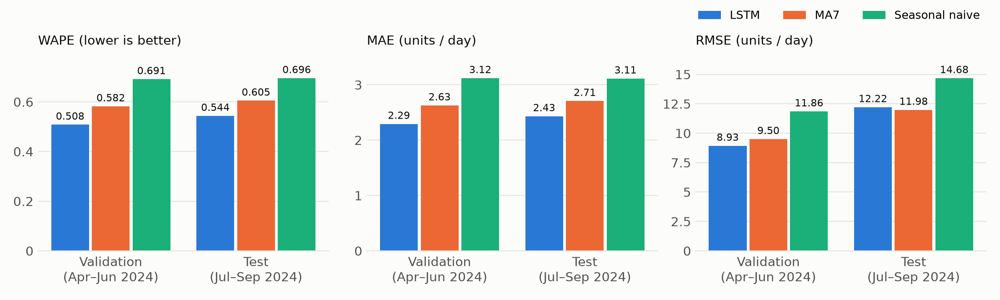
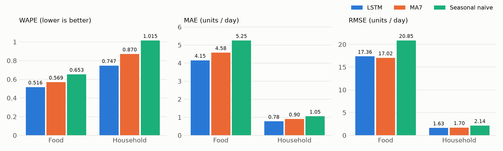
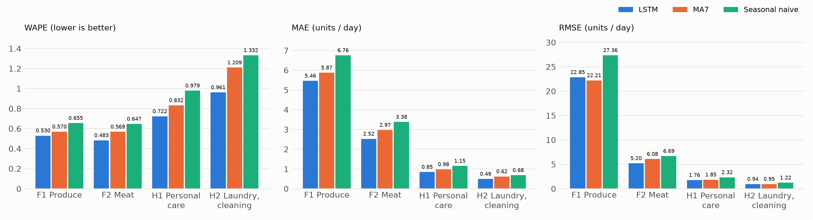

# III. Dataset

## A. Dataset Description

### 1. Data source

The *Retail Sales Forecasting* dataset on Kaggle (`svizor/retail-sales-forecasting-data`) contains real transaction data from a supermarket chain with 4 stores. Department names are in Russian, and item IDs are anonymised as 12-character hashes. The dataset consists of 8 CSV files:

| File | Rows | Main columns | Content | Used |
|---|---|---|---|---|
| `sales.csv` | 7,432,685 | `date`, `item_id`, `store_id`, `quantity`, `price_base`, `sum_total` | In-store sales by day × item × store | Yes: base table, contains the target |
| `discounts_history.csv` | 3,746,744 | price before / during promotion, `promo_type_code`, `doc_id`, `number_disc_day` | Promotion schedule by document | Yes: promotion days, promotion episodes, discount depth |
| `price_history.csv` | 698,626 | `price`, `code` | Price change history | Yes: regular price on non-promotion days |
| `catalog.csv` | 219,810 | `dept_name`, `class_name`, `subclass_name`, `item_type`, weight | Product catalogue, 3 levels of hierarchy | Yes: product group, product attributes |
| `stores.csv` | 4 | `division`, `format`, `city`, `area` | Store information | Yes: static features |
| `online.csv` | 1,123,412 | same as `sales` | Online sales (stores 1 and 4 only) | No: 906,603 rows share keys with `sales`; relationship unclear |
| `markdowns.csv` | 8,979 | regular price, clearance price, quantity | Clearance markdowns | No: only 313 items |
| `actual_matrix.csv` | 35,202 | `item_id`, `date`, `store_id` | Item list by date | No: too sparse, meaning unclear |

Four stores: S1 (Format-1, City1, area 1,500), S2 (Format-6, City1, 210), S3 (Format-7 express, City2, 109), S4 (MaxiEuro, City3, 1,887). S4 only has data from 14 Dec 2023.

### 2. Study scope and processed data

The period is 28 Aug 2022 – 26 Sep 2024 (761 days). Four product groups were chosen along the "perishable vs storable" mechanism (reference paper: Darbanian et al., 2025). The dataset has too few frozen products to replicate the paper's "fresh vs frozen" design, so the project compares Food with Household goods:

| Group | Departments | Items | Item × store pairs | Panel rows | Mean units / day | % zero-sales days |
|---|---|---|---|---|---|---|
| F1 Fresh produce | fruit, vegetables | 613 | 1,437 | 381,968 | 8.61 | 42.8% |
| F2 Fresh and chilled processed meat | meat, poultry, sausages (4 depts) | 505 | 965 | 270,230 | 5.01 | 33.1% |
| H1 Personal care, toilet paper | 2 depts | 826 | 1,342 | 431,835 | 1.16 | 56.6% |
| H2 Laundry, cleaning | 3 depts | 222 | 319 | 113,294 | 0.52 | 67.6% |
| **Total** | 11 depts | **2,166** | **4,063** | **1,197,327** | **4.34** | **48.0%** |

The processed data consists of 3 tables, each serving one type of analysis:

| Table | One row is | Size | Used for |
|---|---|---|---|
| `daily_panel.parquet` | item × store × day | 1,197,327 × 56 columns | ML/DL forecasting models (LSTM, LightGBM, …) |
| `episodes.csv` | 1 real promotion episode (10,044) or 1 placebo episode without promotion (9,700) | 19,744 × 53 columns | Two-way ANOVA, t-test, chi-square, logistic regression, elasticity |
| `group_day.csv` | group × store × day × status | 19,181 × 10 columns | Replicating the paper's 6-label analysis |

### 3. Target variable and descriptive statistics

The target `quantity` (net units sold per day; measured in pieces or kg, so it can be fractional): median 0.63, mean 4.34, standard deviation 17.0, P99 = 71.9, maximum 987.8; 48% of days have zero sales. The distribution is strongly right-skewed with many zeros (intermittent demand). The two sides differ sharply: Food averages 7.12 units/day (38.8% zero days), Household 1.02 (58.9%).

Regarding promotions, 12.4% of rows are discounted promotion days, 2.5% are promotions without a discount, and 85.1% have no promotion. Discount depth (`depth`) on promotion days: median 23.1%, P5 = 7.4%, P95 = 44.0%. Mean units sold: 6.81 on discounted promotion days and 3.78 on non-promotion days. The most common promotion types are code 5 (117,012 rows) and code 6 (45,692). Within the week, Friday has the highest sales (5.25) and Monday the lowest (3.83). 24.6% of rows fall in the COVID-19 period (PHEIC, up to 5 May 2023).

### 4. Variables in `daily_panel`

The panel columns fall into the following groups:

| Group | Variables | Notes |
|---|---|---|
| Keys | `date`, `item_id`, `store_id`, `group4`, `category`, `dept_name`, `class_name`, `subclass_name` | |
| Target | `quantity` | Days with no sales record = 0 (only for regularly sold pairs) |
| Calendar | `dow`, `day_of_month`, `week`, `month`, `is_weekend`, `is_holiday`, `holiday_status`, `days_to_holiday`, `days_after_holiday`, `ny_break`, `pheic`, `store4_period` | Known in advance |
| Planned promotion | `promo_status`, `depth`, `promo_type`, `day_in_promo`, `days_to_promo_end`, `promo_duration`, `days_since_last_promo` | Known in advance (scheduled by the store) |
| Price | `regular_price`, `price`, `price_ratio` | Known in advance |
| Sales history | `lag_7`, `lag_14`, `lag_28`, `roll_mean_7`, `roll_mean_28`, `roll_std_28` | Past only (shifted ≥ 7 days) |
| Static | `item_type`, `weight_volume`, `weight_netto` (+ missing flags), `division`, `format`, `city`, `area` | |
| Analysis labels (not features) | `revenue`, `qty_norm`, `phase`, `status6` | `revenue` and `qty_norm` contain target information |
| Data split | `split` | train / valid / test |

## B. Data Preprocessing

The raw data in `dataset/` is never modified; the whole pipeline lives in `src/prepare_data.py` (about 2 minutes to run, seed = 42). It has 6 stages:

```
8 raw CSVs → [A] Cleaning → [B] Scope selection
           → [C] Select regular pairs, fill zeros, label
           → [D] Build promotion + placebo episodes → [F] Features
           → [S] Train / valid / test split
           → daily_panel.parquet · episodes.csv · group_day.csv
```

### 1. Cleaning (stage A)

| Step | Table | Rule | Rows removed | Reason |
|---|---|---|---|---|
| A1 | all | Drop index column `Unnamed: 0` | | Artefact of CSV export |
| A2 | sales | `quantity`, `sum_total` or `price_base` ≤ 0 | 9,204 | Returns, cancellations, empty rows |
| A3 | sales | \|`sum_total` − `quantity` × `price_base`\| > 1 | 3,075 | Inconsistent monetary fields |
| A4 | discounts | Dates after 26 Sep 2024 | 314,913 | Promotion schedule extends to 2045, outside the sales period |
| A5 | discounts | Pre-promotion price ≤ 0 or promotion price > pre-promotion price | 42,306 | Discount depth cannot be computed |
| A6–A7 | price_history | Duplicate rows; `price` ≤ 0 (incl. `code` 9999999999) | 18,641 + 60,421 | Duplicates, not a selling price |

Two things were deliberately not done: (1) no outlier filtering by IQR/z-score, because it would remove the sales peaks on promotion days and holidays, which are exactly what the study is about; (2) the COVID period was not dropped (that would lose 25% of the data); a `pheic` flag was added instead.

### 2. Scope selection and regular pairs (stages B, C)

Only items present in the catalogue and belonging to the 11 departments of the 4 groups are kept; all of these departments run promotions frequently (≥ 100 episodes and ≥ 20% of items ever promoted). The catalogue is reduced to 21,543 items and sales to 745,332 rows. Three abnormal store days are removed (S3: 16 Oct 2022 closed, 22 Oct 2022 only 10% of normal row count; S4: 13 Dec 2023, its first day). Only the in-store channel (`sales`) is used.

`sales.csv` has no rows for days without sales. The sales density of each pair = number of days with sales / number of days between its first and last sale. 4,063 pairs with density ≥ 0.2 are kept (3,994 pairs removed, i.e. 122,115 rows). For kept pairs, every day inside the active period without a sales row gets `quantity = 0`; days outside that period are "no data" (not zero). Day-level labels are then added: `promo_status` (1 = discounted promotion, taking the deepest discount if documents overlap; 0 = no promotion; NaN = promotion without discount), `holiday_status` (−1 / 0 / 1 around New Year, 23 Feb and 8 Mar on the Russian calendar; this is a hypothesis inferred from the data), the paper's 6 labels `status6`, and the phase `phase` (1–3 days before, during, 1–3 and 4–7 days after a promotion).

### 3. Promotion and placebo episodes (stage D)

Overlapping or adjacent promotion documents of the same pair are merged into 16,163 episodes. Episodes without a discount (2,685), episodes whose window [3 days before, 7 days after] falls outside the data period or touches a no-data day (922 + 1,302), and episodes with another promotion inside the window (1,210) are removed, leaving 10,044 episodes. 9,700 placebo episodes of 14 days with no promotion day are added as a control group: sales can drop after some time even without a promotion (regression to the mean), so comparing only "after" with "before" would overstate the promotion effect.

### 4. Features, data split and checks (stages F, S)

Sales-history features are shifted by ≥ 7 days, so they only use the past. Columns that leak the target (`revenue`, `qty_norm`, `price_base` from sales) are excluded from features. The split is chronological, without shuffling:

| Set | Period | Rows | Role |
|---|---|---|---|
| train | 28 Aug 2022 – 31 Mar 2024 | 814,951 | Fit model parameters |
| valid | 1 Apr – 30 Jun 2024 | 204,663 | Select hyperparameters, early stopping |
| test | 1 Jul – 26 Sep 2024 | 177,713 | Evaluated only once |

The split applies to ML/DL only; `episodes.csv` and `group_day.csv` are used in full for statistical tests. All normalisation / imputation for the models is fitted on the training set only.

After processing, `quantity` has no missing values; the smallest cell of the 6-label table has 50 observations (≥ 30); the largest / smallest group differ by about 2× in number of promotion episodes (large groups are not downsampled). Remaining missing rates: `regular_price` 10.2% (items never priced or promoted), `lag_28` 8.3% (start of series), `days_since_last_promo` 33.6% (never promoted). Tree models handle missing values natively; for the LSTM these values are imputed and flagged as missing.

---

# IV. Model details: encoder–decoder LSTM

A single global model forecasts `quantity` for the next 7 days for all 4,063 item × store pairs. The encoder reads the past $L$ days: log sales, a data-availability flag, and promotion, price and calendar features. The decoder receives only features known in advance for the next 7 days: planned promotions, price, calendar and holidays. Static attributes (store, product group, department, class, format) enter through embeddings. The configuration selected by Manual Grid Search is $L = 56$ days, 128 hidden units and a learning rate of 0.002 (221,533 parameters). On the test set, the LSTM reaches a WAPE of 0.544, versus 0.605 for MA7 and 0.696 for seasonal naive. Source code: `src/train_lstm.py` and `src/lstm_hypothesis_tests.py`.

## 1. Formulas

### 1.1. LSTM cell

With input $\mathbf{x}_\tau$, hidden state $\mathbf{h}$ and cell state $\mathbf{c}$ ($\sigma$ is the sigmoid function, $\odot$ the element-wise product):

$$\mathbf{i}_\tau = \sigma(W_i\mathbf{x}_\tau + U_i\mathbf{h}_{\tau-1} + \mathbf{b}_i),\quad \mathbf{f}_\tau = \sigma(W_f\mathbf{x}_\tau + U_f\mathbf{h}_{\tau-1} + \mathbf{b}_f),\quad \mathbf{o}_\tau = \sigma(W_o\mathbf{x}_\tau + U_o\mathbf{h}_{\tau-1} + \mathbf{b}_o)$$

$$\mathbf{g}_\tau = \tanh(W_g\mathbf{x}_\tau + U_g\mathbf{h}_{\tau-1} + \mathbf{b}_g),\qquad \mathbf{c}_\tau = \mathbf{f}_\tau \odot \mathbf{c}_{\tau-1} + \mathbf{i}_\tau \odot \mathbf{g}_\tau,\qquad \mathbf{h}_\tau = \mathbf{o}_\tau \odot \tanh(\mathbf{c}_\tau)$$

The forget gate $\mathbf{f}$ lets the model retain distant information, such as a promotion several weeks earlier.

### 1.2. Forecast output

The final encoder state is the initial decoder state. The output is the series' base level plus a deviation $z$ learned by an MLP from the decoder output $\mathbf{s}_{t+j}$ and the features of the forecast day itself ($m$ is the data-availability flag):

$$\ell_{i,t} = \frac{\sum_{\tau=t-L+1}^{t} m_{i,\tau}\ln(1+q_{i,\tau})}{\max(1,\ \sum_\tau m_{i,\tau})},\qquad \hat q_{i,t+j} = \max\left(0,\ e^{\,\ell_{i,t} + z_{i,t+j}} - 1\right),\quad j = 1,\dots,7$$

Because of the base level, the network only has to learn "how much higher or lower than usual this day is", so one model can serve both slow- and fast-selling series.

### 1.3. Loss, metrics and tuning

The loss and evaluation metrics are summed over days with data only:

$$\mathcal{L} = \frac{\sum m\,|\hat q - q|}{\sum m},\qquad \text{WAPE} = \frac{\sum|\hat q - q|}{\sum q},\qquad \text{Bias} = \frac{\sum(\hat q - q)}{\sum q}$$

Since the WAPE denominator is fixed, minimising MAE is the same as minimising WAPE.

The configuration is chosen as $\theta^* = \arg\min_{\theta \in \mathcal{G}} \text{WAPE}_{\text{valid}}(\theta)$ over the grid $\mathcal{G} = \{28, 56\} \times \{64, 128\} \times \{0.001,\ 0.002\}$ (lookback × hidden units × learning rate). Each configuration is trained with Adam (batch 1,024) and stopped early when validation WAPE has not improved by $10^{-4}$ for 4 consecutive epochs (at most 40 epochs); the weights of the best epoch are then restored.

## 2. Assumptions

The LSTM is non-parametric, so it does not assume linearity, normal residuals or stationary series. The assumptions it actually needs are:

| Assumption | How it is ensured / checked | Result |
|---|---|---|
| Patterns are stable over time | Compare WAPE train → valid → test | 0.477 → 0.508 → 0.544: partly satisfied |
| No leakage of future information | Decoder only sees known-in-advance features; `revenue` and `qty_norm` excluded; normalisation fitted on train only; chronological split | Satisfied by design |
| The past $L$ days carry enough information | Try $L \in \{28, 56\}$ | $L = 56$ slightly better |
| Series share common dynamics | Base level + embeddings; compare by store and product group | LSTM is best in all 4 stores and 4 groups |
| No-data days differ from zero-sales days | Mask $m$ in the loss and in evaluation | Satisfied by design |
| MAE yields a median forecast, not a mean forecast | Bias test (H4) | Forecasts are 15.6% below actual totals |

Residuals are far from normal (skewness −23.6; kurtosis 1,193; Jarque–Bera $p \approx 0$), so Section 3 uses non-parametric tests or HAC-robust standard errors instead of classical t-tests.

## 3. Hypothesis tests

All tests are run on the test set (1 Jul – 26 Sep 2024, 88 days, 2,530 pairs), α = 0.05. Diebold–Mariano (DM): absolute errors are aggregated by day, with the Harvey–Leybourne–Newbold small-sample correction ($h = 7$):

$$d_t = \sum_i|e^{\text{LSTM}}_{i,t}| - \sum_i|e^{\text{base}}_{i,t}|,\qquad DM = \frac{\bar d}{\sqrt{\hat V_{\text{HAC}}/n}}$$

95% confidence intervals come from a block bootstrap over days. The Wilcoxon signed-rank test compares the per-pair MAE of two models. The bias test is a t-test with HAC standard errors. Ljung–Box checks the autocorrelation of daily errors.

| Hypothesis ($H_1$) | Test | Result | Conclusion |
|---|---|---|---|
| H1. LSTM is more accurate than MA7 | DM, one-sided | ΔWAPE = −0.061 [−0.073, −0.054]; $DM^*$ = −10.69; p = 7.9 × 10⁻¹⁸ | Reject $H_0$ |
| H1'. LSTM is more accurate than seasonal naive | DM, one-sided | ΔWAPE = −0.152 [−0.169, −0.137]; p = 1.3 × 10⁻³¹ | Reject $H_0$ |
| H2. LSTM is better at the series level | Wilcoxon, vs MA7 | Better for 83.7% of pairs; rank-biserial r = 0.75; p < 10⁻³⁰⁰ | Reject $H_0$ |
| H3. The advantage holds across product groups and promotion phases | DM × 6, BH correction | ΔWAPE from −0.04 (during promotion) to −0.29 (4–7 days after); all $p_{BH}$ ≤ 0.015 | Reject $H_0$ |
| H4. Forecasts are biased | HAC t-test | Bias = −15.6% (Food −12.9%, Household −36.1%); p = 1.8 × 10⁻²⁰ | Biased: under-forecasts |
| H5. Errors are autocorrelated | Ljung–Box | Q(7) = 39.9; p < 0.0001 | Autocorrelated |

The LSTM is significantly more accurate than the baselines, both overall and at the level of individual series. Its advantage is largest right after a promotion: MA7 uses the high promotional sales as its base level and over-forecasts, whereas the LSTM has post-promotion features. The trade-off is that the LSTM systematically under-forecasts, most of all for Household goods (sparse series, 57% zero-sales days), because MAE pulls the forecast toward the median. The bias also varies by day of week (from −12% to −19%). For ordering decisions, a Poisson/Tweedie loss or quantile forecasts should be tried.

## 4. Source code with explanations

Excerpts from `src/train_lstm.py` (PyTorch); logging lines are omitted and comments are translated.

```python
class Seq2SeqLSTM(nn.Module):
    def __init__(self, n_enc, n_dec, hid=64, dropout=DROPOUT):
        super().__init__()
        self.embs = nn.ModuleList([nn.Embedding(c, k) for c, k in zip(CARDS, EMB_DIMS)])
        ne = sum(EMB_DIMS)
        self.enc = nn.LSTM(n_enc + ne, hid, batch_first=True)
        self.dec = nn.LSTM(n_dec + ne, hid, batch_first=True)
        self.drop = nn.Dropout(dropout)
        self.head = nn.Sequential(nn.Linear(hid + n_dec + ne, hid), nn.ReLU(), nn.Linear(hid, 1))

    def forward(self, enc, dec, st):
        emb = torch.cat([m(st[:, i]) for i, m in enumerate(self.embs)], -1)
        # base level: mean log1p(q) over days with data (column 0 = log1p(q), column 1 = flag)
        level = (enc[..., 0] * enc[..., 1]).sum(1) / enc[..., 1].sum(1).clamp(min=1)
        _, hc = self.enc(torch.cat([enc, emb[:, None].expand(-1, enc.size(1), -1)], -1))
        d_in = torch.cat([dec, emb[:, None].expand(-1, dec.size(1), -1)], -1)
        out, _ = self.dec(d_in, hc)
        z = self.head(torch.cat([self.drop(out), d_in], -1)).squeeze(-1)
        return level[:, None] + z                        # forecast of log1p(q)
```

- `embs`: embeddings for the 5 static attributes, concatenated to the input at every time step.
- `level` is the base level $\ell_{i,t}$. `hc` is the final encoder state $(\mathbf{h}, \mathbf{c})$, used as the initial decoder state.
- `head` receives both the decoder output and the forecast-day features (`d_in`), so that day's promotion and price act directly on the forecast deviation $z$.

```python
def train_variant(L, hid, lr, tw, vw):
    model = Seq2SeqLSTM(2 + NPR + NCAL, NPR + NCAL, hid=hid).to(DEV)
    opt = torch.optim.Adam(model.parameters(), lr=lr)
    best, bad = np.inf, 0
    for ep in range(1, MAX_EPOCHS + 1):
        idx = rng.choice(len(tw[0]), WIN_PER_EPOCH, replace=False)
        for i in range(0, len(idx), BATCH):
            enc, dec, st, y, o = make_batch(tw[0][idx[i:i+BATCH]], tw[1][idx[i:i+BATCH]], L)
            q_hat = torch.expm1(model(enc, dec, st).clamp(-5, 9))
            loss = ((q_hat - torch.expm1(y)).abs() * o).sum() / o.sum().clamp(min=1)
            opt.zero_grad(); loss.backward(); opt.step()
        w = wape(*predict(model, vw[0], vw[1], L, I_VALID_END))   # WAPE on the hold-out validation set
        if w < best - MIN_DELTA:
            best, bad = w, 0
            best_state = {k: v.clone() for k, v in model.state_dict().items()}
        else:
            bad += 1
            if bad >= PATIENCE:
                break
    model.load_state_dict(best_state)
    return model, best

for L, hid, lr in VARIANTS:                              # Manual Grid Search: 8 configurations
    m, w = train_variant(L, hid, lr, tw, vw)             # keep the one with the lowest validation WAPE
```

- Each epoch samples 150,000 random training windows. The loss is MAE with mask `o`, computed on the original scale (`expm1`); `clamp` prevents overflow when exponentiating.
- After each epoch, validation WAPE drives early stopping (`PATIENCE = 4`, `MIN_DELTA = 1e-4`), and the best weights are restored at the end.
- The test set is not used in this loop; it is evaluated only once for the selected configuration.
- This is a condensed version: the original code also has gradient clipping, `ReduceLROnPlateau` and logging.

To reproduce: `python src/train_lstm.py` (about 90 minutes on a T4 GPU), then `python src/lstm_hypothesis_tests.py` (a few seconds).

---

# V. Model results: MAE / RMSE / WAPE comparison (LSTM)

The LSTM is compared with two baselines: MA7 (mean of the last 7 days) and seasonal naive (same weekday of the previous week). All three models are evaluated on the same rows, with the same weekly blocks and forecast horizons of 1–7 days. The validation set (Apr–Jun 2024) was used to select hyperparameters; the test set (Jul–Sep 2024) was evaluated only once. Results are compared at three levels: overall, by category (Food / Household) and by group (F1, F2, H1, H2). The charts are produced by `src/plot_metrics_comparison.py --lang en`, and the images are in `output/lstm/figures/`.

## 1. Overall comparison

| Set | Model | WAPE | MAE | RMSE |
|---|---|---|---|---|
| Validation | **LSTM** | **0.508** | **2.29** | **8.93** |
| | MA7 | 0.582 | 2.63 | 9.50 |
| | Seasonal naive | 0.691 | 3.12 | 11.86 |
| Test | **LSTM** | **0.544** | **2.43** | 12.22 |
| | MA7 | 0.605 | 2.71 | **11.98** |
| | Seasonal naive | 0.696 | 3.11 | 14.68 |



- **WAPE, MAE:** the LSTM is lowest on both validation and test; on test it cuts WAPE by 10% vs MA7 and 22% vs seasonal naive, and the differences are statistically significant (Diebold–Mariano, Section IV.3).
- **RMSE:** on test the LSTM is slightly above MA7 (12.22 vs 11.98) because, trained with MAE, it tends to under-forecast sales spikes (bias −15.6%).
- **Validation → test:** errors rise for all three models since the test set covers 3 summer months further from the training data, but the ranking on WAPE and MAE does not change.

## 2. Comparison by category

The table below is computed on the test set (Jul–Sep 2024), split by category; mean daily sales is total quantity divided by the number of rows.

| Category | Rows | Mean sales/day | Model | WAPE | MAE | RMSE |
|---|---|---|---|---|---|---|
| Food | 87,185 | 8.04 | **LSTM** | **0.516** | **4.15** | 17.36 |
| | | | MA7 | 0.569 | 4.58 | **17.02** |
| | | | Seasonal naive | 0.653 | 5.25 | 20.85 |
| Household | 90,528 | 1.04 | **LSTM** | **0.747** | **0.78** | **1.63** |
| | | | MA7 | 0.870 | 0.90 | 1.70 |
| | | | Seasonal naive | 1.015 | 1.05 | 2.14 |



- **Difficulty across categories:** Household has a much higher WAPE (0.75–1.02 vs 0.52–0.65) because it sells sparsely, about 1 unit/day; its small MAE and RMSE only reflect low volumes, so WAPE must be used to compare categories.
- **Food:** the LSTM lowers WAPE by 9% vs MA7 (0.516 vs 0.569), but its RMSE is still slightly above MA7 because it under-forecasts very high-sales days.
- **Household:** the LSTM's advantage is largest here, with WAPE 14% below MA7 (0.747 vs 0.870) and the best score on all three metrics.

## 3. Comparison by group

Each category is split into 2 groups (`group4`): F1 Fresh produce, F2 Meat (Food); H1 Personal care, H2 Laundry and cleaning (Household). Figures are computed on the test set.

| Group | Rows | Mean sales/day | Model | WAPE | MAE | RMSE |
|---|---|---|---|---|---|---|
| F1 Fresh produce | 48,319 | 10.31 | **LSTM** | **0.530** | **5.46** | 22.85 |
| | | | MA7 | 0.570 | 5.87 | **22.21** |
| | | | Seasonal naive | 0.655 | 6.76 | 27.36 |
| F2 Meat | 38,866 | 5.22 | **LSTM** | **0.483** | **2.52** | **5.20** |
| | | | MA7 | 0.569 | 2.97 | 6.08 |
| | | | Seasonal naive | 0.647 | 3.38 | 6.69 |
| H1 Personal care | 71,786 | 1.18 | **LSTM** | **0.722** | **0.85** | **1.76** |
| | | | MA7 | 0.832 | 0.98 | 1.85 |
| | | | Seasonal naive | 0.979 | 1.15 | 2.32 |
| H2 Laundry, cleaning | 18,742 | 0.51 | **LSTM** | **0.961** | **0.49** | **0.94** |
| | | | MA7 | 1.209 | 0.62 | 0.95 |
| | | | Seasonal naive | 1.332 | 0.68 | 1.22 |



- **F1 Fresh produce:** the only group where the LSTM loses to MA7 on RMSE (22.85 vs 22.21), because of many very high-sales days; this group is what pushes up the RMSE of Food and of the whole test set.
- **F2 Meat:** the LSTM is best on all three metrics, with WAPE 15% below MA7.
- **H1 Personal care:** the LSTM is best on all three metrics, with WAPE 13% below MA7.
- **H2 Laundry, cleaning:** the hardest group (WAPE near 1, about 0.5 units/day), yet the one where the LSTM beats MA7 by the widest margin (WAPE 21% lower).

## 4. Conclusion

The LSTM has the lowest WAPE and MAE at all three levels: overall, both categories and all four groups. On RMSE it loses to MA7 only in F1 Fresh produce, where sales spikes occur; a Poisson/Tweedie loss or quantile forecasts could address this.
