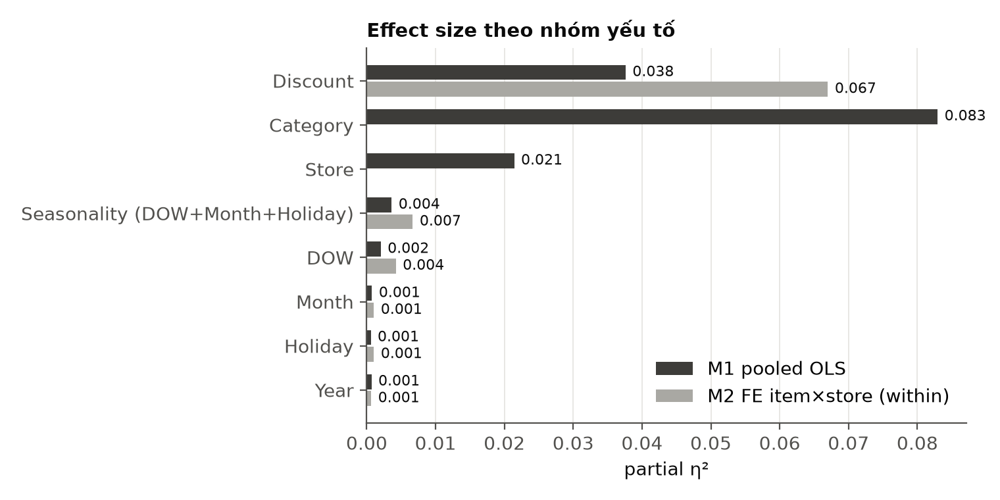
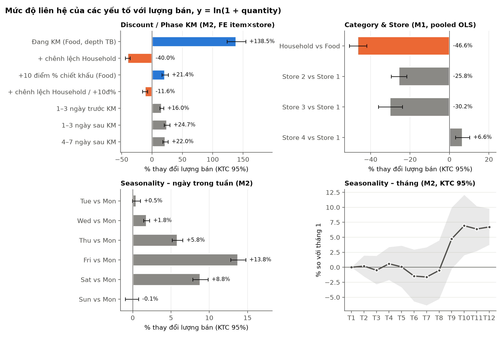
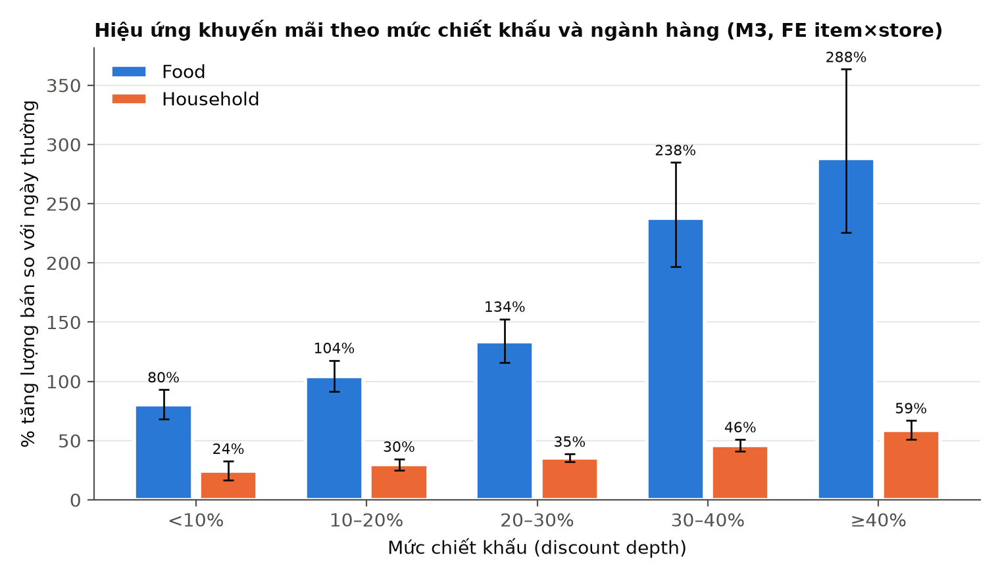
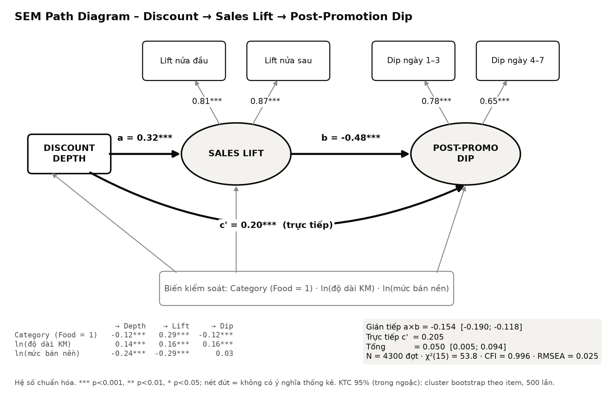

# Regression & SEM – kết quả (phần của Ngọc)

Script: `regression_sem/regression_analysis.py`, `regression_sem/sem_analysis.py`. Dữ liệu: `data/daily_panel.parquet` (không commit).
Log đầy đủ: `outputs/regression_log.txt`, `outputs/sem_log.txt`.

Đây là phân tích **giải thích** (inferential), không phải dự báo, nên dùng toàn bộ panel (train + valid + test, 2022-08-28 → 2024-09-26).

Chạy lại:

```bash
pip install pandas numpy scipy matplotlib pyarrow semopy
python regression_sem/regression_analysis.py > regression_sem/outputs/regression_log.txt
python regression_sem/sem_analysis.py        > regression_sem/outputs/sem_log.txt      # ~10 phút (bootstrap 500 lần)
```

---

## A. Regression: yếu tố nào liên quan đến lượng bán, mức độ liên hệ là bao nhiêu?

### A.1. Thiết kế

- **Biến phụ thuộc:** `y = ln(1 + quantity)`. Hệ số `b` được đọc là **% thay đổi lượng bán ≈ 100·(e^b − 1)**.
- **4 nhóm yếu tố theo yêu cầu report:**

| Nhóm | Biến trong mô hình |
|---|---|
| Discount Depth | phase KM (`pre_1_3`, `during`, `post_1_3`, `post_4_7`; gốc = ngày thường), `depth` (đơn vị +10 điểm %, căn giữa tại depth TB trong KM = 23.4%), tương tác với Household |
| Category | Household (gốc = Food) |
| Store | Store 2, 3, 4 (gốc = Store 1) |
| Seasonality | ngày trong tuần (gốc = Thứ Hai), tháng (gốc = tháng 1), trước lễ / ngày lễ / sau lễ, nghỉ Tết (`ny_break`) |
| Kiểm soát | năm (2023, 2024) |

- **3 mô hình:**
  - **M1 – Pooled OLS:** có Category và Store → so sánh **giữa** các nhóm.
  - **M2 – Fixed effects item×store (4,063 FE):** loại bỏ mức bán cố định của từng sản phẩm ở từng cửa hàng → ước lượng **sạch** cho Discount và Seasonality (Category/Store bị hấp thụ vào FE).
  - **M3 – như M2, depth chia khoảng × Category:** xem hình dạng phi tuyến của hiệu ứng chiết khấu.
- **Sai số chuẩn:** cluster-robust theo `item_id` (2,166 cluster). OLS tự tính bằng phương trình chuẩn để tiết kiệm RAM, đã đối chiếu với `statsmodels` (sai khác hệ số và SE < 1e-11).
- **Effect size:** ΔR² khi bỏ cả khối biến, và partial η² = ΔR² / (1 − R²_full + ΔR²).

N = 1,197,327 dòng (item × store × ngày).

### A.2. Mức độ phù hợp

| Mô hình | R² | within-R² |
|---|---:|---:|
| M1 pooled OLS | 0.150 | – |
| Chỉ FE item×store | 0.509 | – |
| M2 FE + Discount + Seasonality | 0.545 | 0.073 |
| M3 FE + depth bins × Category | – | 0.078 |

→ **Đặc tính riêng của từng sản phẩm × cửa hàng giải thích phần lớn biến động (R² ≈ 0.51).** Trong phạm vi một sản phẩm, khuyến mãi và mùa vụ giải thích thêm ~7% biến động theo ngày.

### A.3. Mức độ liên hệ của từng nhóm (effect size)



| Nhóm yếu tố | partial η² (M1 pooled) | partial η² (M2 FE, within) |
|---|---:|---:|
| **Category** | **0.083** | (hấp thụ trong FE) |
| **Discount / phase KM** | 0.038 | **0.067** |
| Store | 0.021 | (hấp thụ trong FE) |
| Seasonality (DOW + Tháng + Lễ) | 0.004 | 0.007 |
| ├ Ngày trong tuần | 0.002 | 0.004 |
| ├ Tháng | 0.001 | 0.001 |
| └ Lễ / Tết | 0.001 | 0.001 |
| Năm | 0.001 | 0.001 |

- Thứ tự mức độ liên hệ: **Category > Discount > Store ≫ Seasonality**.
- Trong cùng một sản phẩm (M2), **khuyến mãi là yếu tố mạnh nhất**, mạnh gấp ~10 lần mùa vụ.

### A.4. Hệ số chi tiết



**Discount Depth / phase KM (M2, FE item×store)** – % thay đổi lượng bán so với ngày thường, KTC 95%:

| Hệ số | Food | Household |
|---|---:|---:|
| Đang KM, tại depth trung bình (23.4%) | **+138.5%** [123.6; 154.3] | **+43.2%** (= 138.5% kết hợp −40.0% [−43.7; −36.0]) |
| Mỗi +10 điểm % chiết khấu (trong KM) | **+21.4%** [16.2; 26.7] | **+7.3%** (chênh lệch −11.6% [−15.6; −7.3]) |
| 1–3 ngày trước KM | +16.0% [12.9; 19.2] (gộp 2 ngành) | |
| 1–3 ngày sau KM | +24.7% [20.1; 29.5] (gộp 2 ngành) | |
| 4–7 ngày sau KM | +22.0% [17.8; 26.4] (gộp 2 ngành) | |

**Hiệu ứng theo khoảng chiết khấu (M3)** – phi tuyến, rõ nhất ở Food:



| Depth | Food | Household |
|---|---:|---:|
| < 10% | +80% [68; 93] | +24% [16; 33] |
| 10–20% | +104% [92; 118] | +30% [25; 35] |
| 20–30% | +134% [116; 153] | +35% [32; 39] |
| 30–40% | +238% [197; 285] | +46% [41; 51] |
| ≥ 40% | +288% [225; 363] | +59% [51; 67] |
| 1–3 ngày trước KM | +28% [22; 34] | +2.4% [1.2; 3.6] |
| 1–3 ngày sau KM | +49% [41; 58] | **−3.2%** [−4.5; −1.9] |
| 4–7 ngày sau KM | +39% [32; 47] | +1.2% [−0.0; 2.4] |

**Category & Store (M1, pooled):**

| Hệ số | % thay đổi | KTC 95% |
|---|---:|---|
| Household so với Food | **−46.6%** | [−50.8; −42.0] |
| Store 2 so với Store 1 | −25.8% | [−29.6; −21.7] |
| Store 3 so với Store 1 | −30.2% | [−36.0; −23.9] |
| Store 4 so với Store 1 | +6.6% | [+3.0; +10.3] |

**Seasonality (M2):**

| Hệ số | % thay đổi | KTC 95% |
|---|---:|---|
| Thứ Sáu vs Thứ Hai | **+13.8%** | [12.8; 14.8] |
| Thứ Bảy vs Thứ Hai | +8.8% | [7.9; 9.8] |
| Thứ Năm vs Thứ Hai | +5.8% | [5.2; 6.5] |
| Chủ Nhật vs Thứ Hai | −0.1% (không ý nghĩa) | [−1.0; 0.8] |
| Tháng 10 / 11 / 12 vs tháng 1 | +6.9% / +6.4% / +6.7% | p < 0.01 |
| Tháng 2–8 vs tháng 1 | −1.6% … +0.6% (không ý nghĩa) | |
| Những ngày trước lễ | **+11.4%** | [9.7; 13.1] |
| Ngày lễ | −4.5% | [−5.9; −3.0] |
| Nghỉ Tết (`ny_break`) | **−9.4%** | [−11.1; −7.6] |

### A.5. Kết luận Regression

1. **Discount Depth có liên hệ mạnh nhất trong phạm vi một sản phẩm.** Khi đang KM, lượng bán Food tăng ~2.4 lần (+138%), Household tăng +43%. Chiết khấu càng sâu, lượng bán càng tăng, và **tăng nhanh hơn tuyến tính** ở Food (≥ 30%: gần gấp 3.4–3.9 lần).
2. **Category là yếu tố phân biệt mức bán lớn nhất giữa các sản phẩm** (partial η² = 0.083). Household bán ít hơn Food ~47% mỗi ngày và **phản ứng với KM yếu hơn nhiều** (đường cong depth thoải hơn).
3. **Store:** Store 1 và 4 bán nhiều nhất, Store 2–3 thấp hơn 26–30%. Điều này khớp với format/quy mô cửa hàng.
4. **Seasonality có ý nghĩa thống kê nhưng mức độ nhỏ** (partial η² < 0.01): đỉnh vào Thứ Sáu (+14%) và Thứ Bảy, quý 4 cao hơn ~7%, ngay trước lễ +11%, nghỉ Tết −9%.
5. **Sau KM:** Food **không bị sụt** mà còn cao hơn ngày thường (+39–49%). Nguyên nhân có thể là hiệu ứng ghi nhớ (carry-over) hoặc KM rơi vào giai đoạn nhu cầu đang cao. Household có **dip nhỏ** (−3.2% trong 1–3 ngày sau KM), phù hợp với hành vi tích trữ hàng không dễ hỏng. Cơ chế này được phân tích tiếp bằng SEM ở phần B.

*Hạn chế:* depth không được gán ngẫu nhiên. Nhà bán lẻ có thể chọn KM vào lúc nhu cầu cao, nên hệ số mang tính **liên hệ**, chưa phải nhân quả. FE item×store đã loại bỏ được khác biệt cố định giữa các sản phẩm, nhưng chưa loại bỏ được cú sốc nhu cầu theo thời gian.

---

## B. SEM: chiết khấu, Sales Lift và Post-Promotion Dip liên hệ qua cơ chế nào?

### B.1. Dữ liệu cho SEM: mỗi quan sát là một đợt khuyến mãi

Một **đợt KM** là chuỗi ngày liên tiếp `promo_status = 1` của một cặp item×store.

| Bước lọc | Số đợt còn lại |
|---|---:|
| Tổng số đợt KM | 12,924 |
| Độ dài 4–35 ngày (đợt rất dài, tới 604 ngày, thực chất là giá cố định) | 12,087 |
| Đủ baseline: ≥ 6 ngày thường trong mỗi nửa của 28 ngày trước KM | 5,750 |
| Có bán trong baseline (cả 2 nửa > 0) | 4,851 |
| 7 ngày sau KM đủ dữ liệu, không có KM mới chen vào | **4,300** |

→ **4,300 đợt** (Food 2,379, Household 1,921) của 891 sản phẩm.

**Định nghĩa biến** (c = 0.1 để tránh chia cho 0; các chỉ báo được winsorize ở mức 1%–99%):

| Biến | Định nghĩa |
|---|---|
| `DEPTH` | chiết khấu TB trong đợt, đơn vị 10 điểm % |
| `SALES LIFT` (biến ẩn) | đo bằng 2 chỉ báo: `lift_early`, `lift_late` = ln((lượng bán TB nửa đầu / nửa sau đợt + c) / (baseline_A + c)) |
| `POST-PROMO DIP` (biến ẩn) | đo bằng 2 chỉ báo: `dip_13`, `dip_47` = ln((baseline_B + c) / (lượng bán TB ngày +1…+3 / +4…+7 + c)). **DIP > 0 nghĩa là sau KM bán thấp hơn mức nền.** |
| Biến kiểm soát | `FOOD` (1 = food), `DUR` = ln(số ngày KM), `BASE` = ln(baseline_A + c) (tốc độ bán nền) |

**Vì sao chia baseline thành 2 nửa (ngày chẵn/lẻ trong 28 ngày trước KM)?** Nếu LIFT và DIP cùng chia cho một baseline, khi baseline thấp do ngẫu nhiên thì LIFT cao và DIP thấp cùng lúc. Điều đó tạo ra tương quan âm giả giữa LIFT và DIP. Dùng baseline_A cho LIFT và baseline_B cho DIP sẽ làm nhiễu của hai biến độc lập nhau. Mỗi nửa chứa đủ mỗi thứ trong tuần đúng 2 lần. Kiểm tra R1 bên dưới cho thấy dùng chung baseline làm hệ số `b` âm mạnh hơn (−0.62 so với −0.50), đúng như dự đoán.

Thống kê mô tả (trung vị theo đợt):

| | Food | Household |
|---|---:|---:|
| Depth | 15.9% | 26.3% |
| Độ dài đợt | 7 ngày | 14 ngày |
| Lift (lượng bán trong KM / baseline − 1) | +75% | +121% |
| Lượng bán 7 ngày sau KM / baseline − 1 | **+2.6%** | **−12.4%** |

### B.2. Mô hình

```
Đo lường:  LIFT =~ lift_early + lift_late
           DIP  =~ dip_13 + dip_47
Cấu trúc:  DEPTH ~ FOOD + DUR + BASE
           LIFT  ~ a·DEPTH + FOOD + DUR + BASE
           DIP   ~ b·LIFT + c'·DEPTH + FOOD + DUR + BASE
```

- Ước lượng bằng `semopy` 2.3 (Maximum Likelihood, Wishart).
- **Hiệu ứng gián tiếp** DEPTH → LIFT → DIP = a·b. **Tổng** = c' + a·b.
- **KTC 95%:** cluster bootstrap theo `item_id`, 500 lần (500/500 lần hội tụ).
- **Đa nhóm:** ước lượng riêng cho Food và Household, rồi so sánh bằng bootstrap.

### B.3. SEM Path Diagram



Path diagram riêng cho từng ngành hàng: [Food](fig_sem_path_food.png), [Household](fig_sem_path_household.png).

**Chỉ số phù hợp:**

| Mô hình | N | χ² (df) | p | CFI | TLI | RMSEA | GFI |
|---|---:|---|---:|---:|---:|---:|---:|
| Gộp | 4,300 | 53.8 (15) | < 0.001 | 0.996 | 0.992 | 0.025 | 0.995 |
| Food | 2,379 | 45.6 (10) | < 0.001 | 0.993 | 0.984 | 0.039 | 0.991 |
| Household | 1,921 | 6.2 (10) | 0.80 | 1.000 | 1.005 | 0.000 | 0.997 |

→ Mô hình **phù hợp tốt**: CFI > 0.95, RMSEA < 0.06. χ² có ý nghĩa ở mẫu gộp là điều bình thường khi N lớn. Các factor loading chuẩn hóa nằm trong khoảng 0.49–0.91 (đều p < 0.001), nên 2 chỉ báo đo tốt cùng một biến ẩn.

### B.4. Hiệu ứng trực tiếp và gián tiếp

Hệ số **chuẩn hóa** (KTC 95% bootstrap):

| Đường dẫn | Gộp | Food | Household |
|---|---:|---:|---:|
| a: Depth → Lift | **0.32** [0.26; 0.37] | 0.39 [0.30; 0.47] | 0.16 [0.09; 0.23] |
| b: Lift → Dip | **−0.48** [−0.54; −0.42] | −0.65 [−0.71; −0.59] | −0.23 [−0.34; −0.11] |
| c': Depth → Dip (trực tiếp) | **+0.20** [0.16; 0.25] | +0.25 [0.19; 0.32] | +0.16 [0.08; 0.23] |
| a·b: Depth → Lift → Dip (gián tiếp) | **−0.15** [−0.19; −0.12] | −0.26 [−0.32; −0.19] | −0.04 [−0.06; −0.01] |
| Tổng: Depth → Dip | +0.05 [0.005; 0.09] | −0.00 [−0.06; 0.06] | **+0.13** [0.05; 0.19] |

Hệ số **chưa chuẩn hóa** đổi ra %, đơn vị +10 điểm % chiết khấu:

| | Food | Household | Khác biệt Food − Household (KTC 95%) |
|---|---|---|---|
| a | lượng bán trong KM **+37%** | +12% | 0.20 [0.11; 0.28] |
| c' (giữ LIFT không đổi) | lượng bán sau KM **−19%** | −10% | 0.10 [0.03; 0.17] |
| a·b | sau KM +23% | +2% | −0.19 [−0.23; −0.14] |
| **Tổng** | **≈ 0%** [−5%; +5%] | **−8%** [−3%; −12%] | −0.08 [−0.15; −0.01] |


### B.5. Các yếu tố liên hệ với nhau qua cơ chế nào?

Kết quả là **trung gian cạnh tranh (competitive mediation)**: chiết khấu tác động lên Post-Promotion Dip theo **hai đường ngược chiều**.

1. **Đường trực tiếp c' > 0: kéo cầu về trước / tích trữ (pull-forward, stockpiling).** So sánh hai đợt có cùng mức Lift, đợt chiết khấu sâu hơn bị sụt sau KM nhiều hơn. Lý do: một phần lượng mua trong KM là **mua sớm** cho nhu cầu tương lai, nên sau KM khách hàng mua ít đi.
2. **Đường gián tiếp a·b < 0: lan tỏa / duy trì (carry-over).**
   - a > 0: chiết khấu sâu hơn làm Lift lớn hơn.
   - b < 0: đợt có Lift lớn **không** bị sụt mạnh hơn; ngược lại, lượng bán sau KM vẫn ở mức cao. Lift lớn phản ánh nhu cầu thực sự mở rộng (khách mới dùng thử, sản phẩm được trưng bày nổi bật hơn) hoặc sản phẩm đang trong giai đoạn nhu cầu cao.
3. **Ngành hàng quyết định đường nào thắng thế** (khác biệt đa nhóm đều có ý nghĩa, p < 0.05):
   - **Food** (đồ tươi, dễ hỏng, khó tích trữ): hai đường gần như **triệt tiêu nhau**. Hiệu ứng tổng của chiết khấu lên Dip ≈ 0, nên KM Food **không gây sụt sau KM**. Kết quả này khớp với Regression: sau KM, Food vẫn bán cao hơn ngày thường.
   - **Household** (hàng dễ tích trữ): Lift tăng ít theo depth (a nhỏ) và gần như không có carry-over (b nhỏ), nên **đường tích trữ trực tiếp chiếm ưu thế**. Mỗi +10 điểm % chiết khấu làm lượng bán 7 ngày sau KM **giảm thêm ~8%** so với mức nền. Đây chính là post-promotion dip, khớp với hệ số −3.2% ở Regression M3.

**Hàm ý:** chiết khấu sâu cho Household phần lớn chỉ dời doanh số về sớm hơn, phải trả giá bằng dip sau KM. Với Food, chiết khấu sâu tạo ra mức tăng lớn mà không bị "trả lại" sau KM.

### B.6. Kiểm tra độ vững (robustness)

| Mô hình | a | b | c' | a·b | Tổng |
|---|---:|---:|---:|---:|---:|
| Chính (baseline chia đôi, biến ẩn) | 0.32 | −0.48 | 0.20 | −0.15 | 0.05 |
| R1: dùng chung một baseline | 0.34 | −0.63 | 0.30 | −0.22 | 0.08 |
| R2: path analysis với biến quan sát (TB 2 chỉ báo, không có biến ẩn) | 0.30 | −0.35 | 0.14 | −0.10 | 0.04 |

*(hệ số chuẩn hóa, mẫu gộp)*

- Dấu và mức ý nghĩa của mọi đường dẫn **giữ nguyên** trong cả 3 cách ước lượng.
- R1 phóng đại b, đúng như dự đoán về tương quan giả do dùng chung baseline.
- R2 cho hệ số nhỏ hơn vì sai số đo lường làm suy giảm hệ số (attenuation). Đây là lý do nên dùng biến ẩn.

### B.7. Hạn chế

- Mẫu SEM chỉ gồm các đợt KM có baseline "sạch" (4,300 / 12,924 đợt). Các sản phẩm được KM liên tục hoặc bán rất thưa bị loại. Vì thế mức Lift và Dip trong mẫu SEM khác với hệ số Regression (vốn tính trên mọi ngày, theo thang ln(1 + q)).
- Hệ số b < 0 có thể một phần do **cú sốc nhu cầu chung**: một sản phẩm đang "hot" vừa có Lift cao vừa bán tốt sau KM. Dữ liệu quan sát không tách được hoàn toàn yếu tố này khỏi carry-over thật sự. SEM ở đây chỉ ra **cấu trúc liên hệ** phù hợp với dữ liệu, chưa phải bằng chứng nhân quả.
