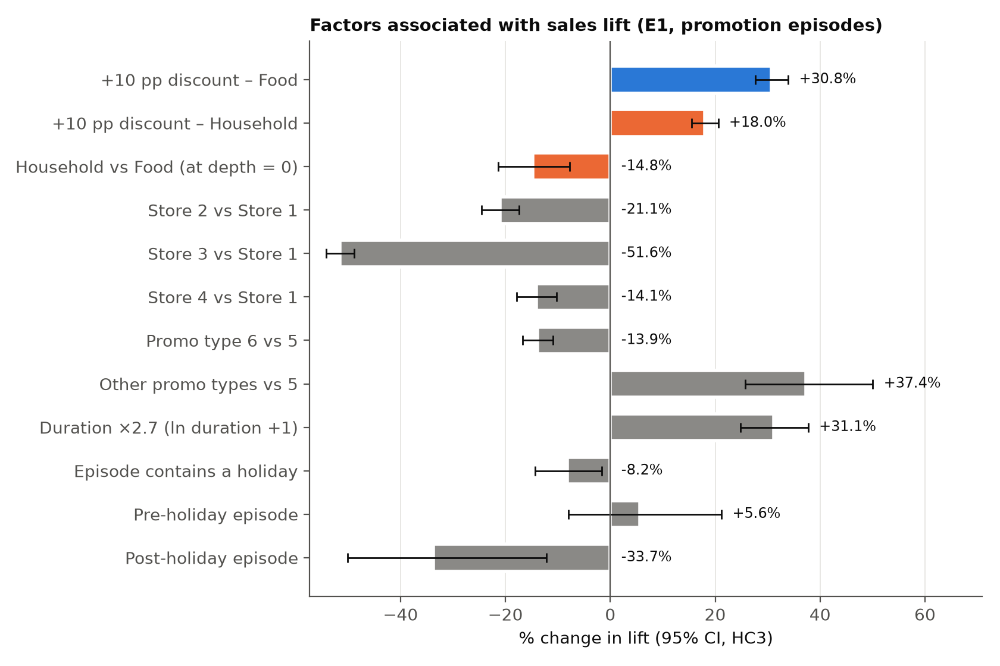
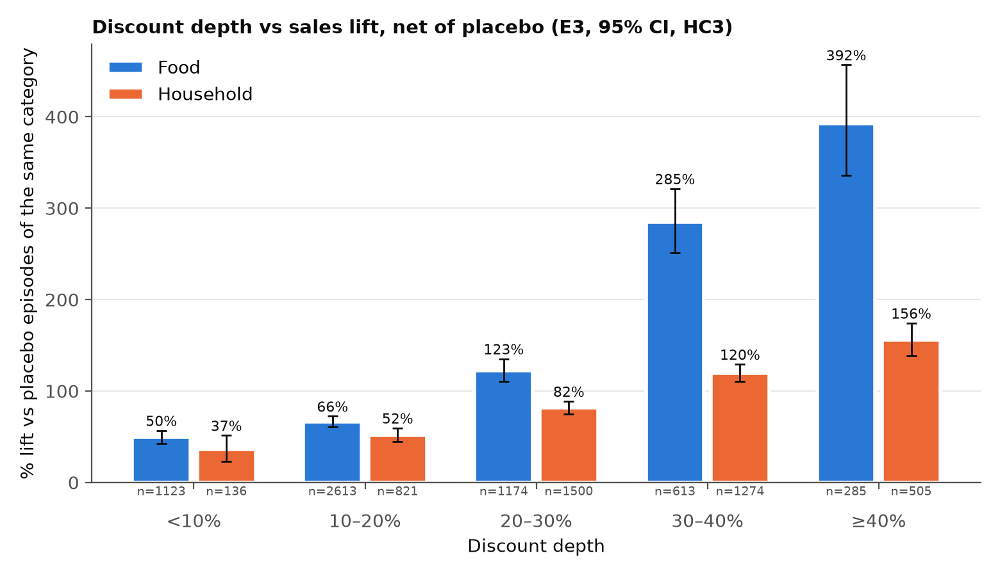
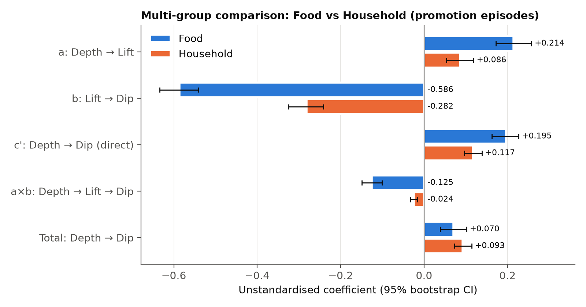
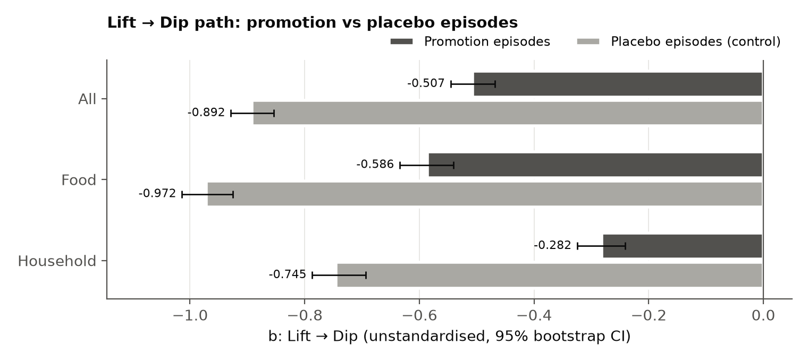

# Regression & SEM – kết quả (phần của Ngọc)

**Thống nhất với EDA và pipeline chung của nhóm** (`bao_cao_pipeline_tien_xu_ly.md`):

- Dữ liệu kiểm định: `episodes.csv`, gồm 10,044 đợt KM thật và 9,700 đợt giả (placebo).
- Cửa sổ trước KM là 1–3 ngày; sau KM gồm 1–3 ngày và 4–7 ngày.
- Biến: `log_lift`, `log_post13`, `log_post47` = ln((x + 1/3) / (pre_qty + 1/3)).
- **Luôn so sánh KM thật với đợt giả.** Sai số chuẩn dùng HC3 hoặc bootstrap; luôn báo cáo cỡ hiệu ứng và KTC 95%.
- Theo EDA, các phân tích kiểm soát `store_id`, `category`, `promo_type` và seasonality.

Toàn bộ là phân tích **giải thích** nên dùng hết dữ liệu (không chia train/test).

| Script | Dữ liệu | Nội dung |
|---|---|---|
| `inferential_tests.py` | `data/episodes.csv` | **0 – Inferential**: paired t-test, one-way RM ANOVA, two-way mixed ANOVA (xem mục 0 bên dưới) |
| `regression_episodes.py` | `data/episodes.csv` | **A1 – Regression chính** (cấp đợt KM, theo EDA mục 4) |
| `regression_analysis.py` | `data/daily_panel.parquet` | A2 – Regression bổ trợ (cấp ngày: Category, Store, Seasonality theo thứ/tháng) |
| `sem_analysis.py` | `data/episodes.csv` | B – SEM + path diagram |

Chạy lại (chép `daily_panel.parquet` và `episodes.csv` từ `data_model/` của pipeline vào `data/`):

```bash
pip install pandas numpy scipy statsmodels matplotlib pyarrow semopy
python regression_sem/regression_episodes.py > regression_sem/outputs/regression_episodes_log.txt
python regression_sem/regression_analysis.py > regression_sem/outputs/regression_log.txt
python regression_sem/sem_analysis.py        > regression_sem/outputs/sem_log.txt      # ~10 phút (bootstrap 500 lần)
```

---

## 0. Inferential: kiểm định 3 khác biệt mà phần Descriptive đã chỉ ra

Mẫu giống hệt phần Descriptive: các đợt **có bán đủ cả 3 ngày trước KM** (`pre_days = 3`), gồm 3,564 đợt KM thật (Food 3,311, Household 253) và 2,740 đợt giả. Robustness: chạy lại trên toàn bộ đợt. Mọi phép kiểm định dùng thang log: y = ln(q + 1/3).

| Khác biệt | Kiểm định | Kết quả chính |
|---|---|---|
| Trước vs trong KM | Paired t-test (+ Wilcoxon); KM thật vs đợt giả bằng Welch | +59.9% (t(3,563) = 39.5, p < 0.001, d_z = 0.66). So với đợt giả: Food +92.9%, Household +55.8% |
| Giữa các phase | One-way **repeated-measures** ANOVA (Greenhouse–Geisser), post-hoc Holm, Friedman | F(3; 10,689) = 954.5, p < 0.001, η²p = 0.21. 4–7 ngày sau KM thấp hơn trước KM 18.4%, nhưng đợt giả còn giảm 30% → phần lớn là hồi quy về trung bình |
| Phase × Category | Two-way mixed ANOVA + ANOVA category × source (HC3) | Tương tác F(3; 10,686) = 34.3, p < 0.001, η²p = 0.010 (ở đợt giả chỉ 0.002). So với đợt giả: Food sau KM **cao hơn** (+40% / +19%); Household 4–7 ngày sau **thấp hơn 17.1%** (p < 0.001) |

- **Robustness:** trên toàn bộ đợt, dip của Household biến mất (−1.1%, p = 0.48), vì 28% đợt không bán gì trong 3 ngày trước KM. Vì vậy dip của Household chỉ đúng với hàng Household bán đều mỗi ngày.
- **Kết quả:** `inf_*.csv`, `fig_inf_paired.png`, `fig_inf_oneway.png`, `fig_inf_interaction.png`, `inferential_log.txt`.
- **Bản tiếng Anh:** phương pháp, kết quả và business implications đầy đủ nằm trong `no commit/ngoc.docx` (không commit).

---

## A. Regression: yếu tố nào liên quan đến lượng bán và mức độ liên hệ là bao nhiêu?

### A1. Hồi quy cấp đợt KM (chính) – Discount Depth, Category, Store, Seasonality → Sales Lift

EDA trang 9 đề xuất: *"sử dụng hồi quy để kiểm tra quan hệ giữa `depth` và `log_lift`, đồng thời kiểm soát `store_id`, `category`, `promo_type` và seasonality"*. EDA trang 10 đề xuất thêm: *"kiểm tra quan hệ `discount_depth × category`"*.

| Mô hình | Mẫu | Công thức (OLS, SE HC3) |
|---|---|---|
| **E1** | 10,044 đợt KM thật | `log_lift ~ depth + depth×category + category + store + promo_type + tháng + lễ + năm + ln(duration)` |
| **E2** | 19,744 đợt (thật + giả) | `log_lift ~ promo × category + store + tháng + lễ + năm` → lift của KM **so với đối chứng** |
| **E3** | 19,744 đợt (thật + giả) | `log_lift ~ (khoảng depth × category) + category + kiểm soát như E2` |

- `depth` tính theo đơn vị +10 điểm %. Hệ số được đổi ra % thay đổi của lift: 100·(e^b − 1).
- `promo_type` giữ 2 loại chính là 5 (63% số đợt) và 6 (31%); các loại còn lại gộp thành "khác".
- **Không dùng thứ bắt đầu đợt** làm biến mùa vụ: KM gần như luôn bắt đầu từ Thứ 2 đến Thứ 5 (69% vào Thứ 5, chỉ 2 đợt vào Chủ nhật). Đây là thuộc tính lịch KM, và nó gần như trùng với biến KM thật/giả. Mùa vụ theo thứ được phân tích ở A2 (cấp ngày).

**Độ phù hợp:** E1 R² = 0.199, E2 R² = 0.181, E3 R² = 0.241.

#### Mức độ liên hệ (partial η²)

| Nhóm yếu tố (E1, đợt KM thật) | partial η² |
|---|---:|
| **Discount depth** (depth + depth × category) | **0.081** |
| Store | 0.059 |
| Category | 0.041 |
| Promo type | 0.019 |
| Độ dài đợt | 0.019 |
| Seasonality (tháng + lễ) | 0.003 |
| Năm | 0.000 |

Ở E2 (KM thật vs đợt giả), riêng **việc có KM** đạt partial η² = **0.162**.

→ Thứ tự mức độ liên hệ với lift: **KM / Discount depth > Store > Category > Promo type ≈ Độ dài ≫ Seasonality.**

#### Hệ số (E1) – % thay đổi của lift, KTC 95% HC3



| Yếu tố | % thay đổi lift | KTC 95% |
|---|---:|---|
| **+10 điểm % chiết khấu – Food** | **+30.8%** | [27.7; 33.9] |
| **+10 điểm % chiết khấu – Household** | **+18.0%** | [15.5; 20.6] |
| Chênh lệch độ dốc Household − Food (depth × category) | −9.8% | [−12.6; −6.9], p < 0.001 |
| Household so với Food (tại depth = 0) | −14.8% | [−21.3; −7.7] |
| Store 2 / 3 / 4 so với Store 1 | −21.1% / −51.6% / −14.1% | đều p < 0.001 |
| Promo type 6 so với 5 | −13.9% | [−16.7; −11.0] |
| Promo type khác so với 5 | +37.4% | [25.7; 50.1] |
| ln(duration) +1 (đợt dài gấp ~2.7 lần) | +31.1% | [24.9; 37.7] |
| Đợt chứa ngày lễ / đợt sau lễ | −8.2% / −33.7% | p = 0.02 / 0.004 |
| Tháng bắt đầu (so với tháng 1) | chỉ tháng 12 có ý nghĩa: −10.5% | p = 0.03 |

#### Có đối chứng đợt giả (E2, E3)

| | Food | Household |
|---|---:|---:|
| Trung vị lift, đợt KM thật | 1.85 | 1.71 |
| Trung vị lift, đợt giả | 0.95 | 0.86 |
| **Lift của KM so với đợt giả (E2)** | **+99.3%** [93.4; 105.4] | **+91.4%** [86.1; 96.9] |

Khác biệt Food − Household ở E2 **không có ý nghĩa** (−4.0%, p = 0.053). Ở mức depth trung bình của từng ngành, hai ngành tăng gần như nhau. Khác biệt nằm ở **độ nhạy với depth** (E1, E3).



| Depth | Food | Household |
|---|---:|---:|
| < 10% | +50% [43; 57] | +37% [23; 51] |
| 10–20% | +66% [60; 72] | +52% [44; 59] |
| 20–30% | +123% [111; 135] | +82% [75; 89] |
| 30–40% | +285% [251; 321] | +120% [111; 129] |
| ≥ 40% | +392% [336; 457] | +156% [138; 174] |

*(% lift so với đợt giả cùng ngành hàng; số đợt trong từng ô: `reg_episode_depthbin_counts.csv`)*

### A2. Hồi quy cấp ngày (bổ trợ) – Category, Store, Seasonality

`regression_analysis.py`, N = 1,197,327 dòng (item × store × ngày), biến phụ thuộc `ln(1 + quantity)`, sai số chuẩn cluster theo item.

- **M1 – pooled OLS:** có Category và Store.
- **M2 – fixed effects item × store:** loại bỏ mức bán cố định của từng sản phẩm ở từng cửa hàng, nên kiểm soát được **composition effect** của Store 4 mà EDA trang 3 đã chỉ ra.
- **M3:** như M2 nhưng chia depth thành khoảng.


| Yếu tố | % thay đổi lượng bán/ngày | Ghi chú |
|---|---:|---|
| Household so với Food | −46.6% [−50.8; −42.0] | M1; partial η² = 0.083, lớn nhất |
| Store 2 / 3 / 4 so với Store 1 | −25.8% / −30.2% / +6.6% | M1; partial η² = 0.021 |
| Đang KM, Food / Household (depth TB 23%) | +138% / +43% | M2 |
| **Thứ Sáu** so với Thứ Hai | **+13.8%** [12.8; 14.8] | M2; khớp EDA trang 11 |
| Thứ Bảy / Thứ Năm so với Thứ Hai | +8.8% / +5.8% | Chủ nhật ≈ Thứ Hai |
| Tháng 10–12 so với tháng 1 | +6.4% … +6.9% (p < 0.01) | Tháng 2–8 không khác có ý nghĩa |
| Những ngày trước lễ / nghỉ Tết | +11.4% / −9.4% | |

Effect size theo ngày ([hình](fig_reg_effect_sizes.png)):

- Ở M1, Category (0.083) > Discount (0.038) > Store (0.021) ≫ Seasonality (0.004).
- Ở M2 (trong cùng một sản phẩm), Discount (0.067) ≫ Seasonality (0.007).

### A3. Kết luận Regression

1. **Discount depth là yếu tố liên hệ mạnh nhất với Sales Lift** (partial η² = 0.081; có KM so với đợt giả: 0.162).
   - Mỗi +10 điểm % chiết khấu làm lift tăng +31% với Food và +18% với Household.
   - Hiệu ứng **tăng nhanh hơn tuyến tính**: chiết khấu từ 40% trở lên cho Food +392%, Household +156% so với đợt giả.
2. **Tương tác depth × category có ý nghĩa** (p < 0.001), đúng câu hỏi EDA trang 10 đặt ra. Household **có** phản ứng với depth (+18% / 10 điểm %, p < 0.001), nhưng yếu hơn Food.
3. **Store** có liên hệ lớn thứ hai: lift ở Store 3 chỉ bằng khoảng một nửa Store 1. Ở cấp ngày, Store 2–3 bán ít hơn Store 1 từ 26–30%.
4. **Category:**
   - Theo ngày, Household bán ít hơn Food 47%.
   - Tính tại mức depth trung bình của từng ngành, mức tăng do KM của hai ngành gần như nhau (+99% so với +91%).
   - Khác biệt chính nằm ở **độ nhạy với mức giảm giá**.
5. **Seasonality** có ý nghĩa thống kê nhưng nhỏ: đỉnh vào Thứ Sáu (+14%), quý 4 cao hơn khoảng 7%, những ngày trước lễ +11%. KM rơi vào kỳ lễ hoặc sau lễ có lift thấp hơn.
6. **Promo type:** loại 6 cho lift thấp hơn loại 5 khoảng 14%.

*Hạn chế:* mức giảm do cửa hàng tự chọn, nên các hệ số là **liên hệ**, chưa phải nhân quả (pipeline, mục 8.6).

---

## B. SEM: chiết khấu, Sales Lift và Post-Promotion Dip liên hệ qua cơ chế nào?

### B.1. Dữ liệu và biến

`episodes.csv` gồm **10,044 đợt KM thật** (Food 5,808, Household 4,236) và **9,700 đợt giả** (Food 5,421, Household 4,279). Mọi biến đều lấy đúng định nghĩa của pipeline:

| Biến SEM | Định nghĩa |
|---|---|
| `DEPTH` | `depth`, đơn vị +10 điểm % (chỉ có ở đợt KM thật) |
| `SALES LIFT` | `log_lift` = ln((during_qty + 1/3) / (pre_qty + 1/3)) |
| `POST-PROMO DIP` (biến ẩn) | đo bằng 2 chỉ báo **−log_post13** và **−log_post47**. DIP > 0 nghĩa là sau KM bán thấp hơn trước KM |
| Kiểm soát | `FOOD`, ln(duration), **ln(pre_qty + 1/3)**, cửa hàng (S2, S3, S4), promo_type (6, khác), lễ (`hol_status` ≠ normal) |

**Vì sao phải kiểm soát ln(pre_qty + 1/3):** `log_lift` và `log_post` dùng **chung** cửa sổ pre chỉ 3 ngày.
- LIFT = ln(during + c) − ln(pre + c) và DIP = ln(pre + c) − ln(post + c).
- Khi pre thấp do ngẫu nhiên, LIFT bị đẩy lên còn DIP bị kéo xuống cùng lúc. Kết quả là một tương quan âm giả giữa hai biến.
- Đưa ln(pre + c) vào cả phương trình LIFT và DIP sẽ triệt tiêu đúng thành phần chung này. Mục B.6 (R1) cho thấy nếu bỏ biến này, kết luận thay đổi hẳn.

### B.2. Mô hình

```
DIP   =~ dip13 + dip47                                  (dip13 = −log_post13, dip47 = −log_post47)
DEPTH ~ FOOD + DUR + BASE + S2 + S3 + S4 + HOL + PT6 + PTO
LIFT  ~ a·DEPTH + (các biến kiểm soát như trên)
DIP   ~ b·LIFT + c'·DEPTH + (các biến kiểm soát như trên)
```

- Ước lượng bằng `semopy` 2.3 (ML, Wishart).
- Hiệu ứng gián tiếp = a·b; hiệu ứng tổng = c' + a·b.
- **KTC 95%:** cluster bootstrap theo `item_id`, 500 lần. Mỗi lần lấy mẫu lại item **một lần chung cho mọi mô hình**, nên các phép so sánh giữa nhóm có KTC đúng.
- **Đa nhóm:** Food so với Household.
- **Đối chứng:** cùng mô hình chạy trên **đợt giả** (không có DEPTH, PT). Theo đúng nguyên tắc "luôn so KM thật với đợt giả" của pipeline.

### B.3. SEM Path Diagram


Path diagram riêng: [Food](fig_sem_path_food.png), [Household](fig_sem_path_household.png).

| Mô hình | N | χ² (df) | p | CFI | TLI | RMSEA |
|---|---:|---|---:|---:|---:|---:|
| KM thật – gộp | 10,044 | 177.2 (55) | < 0.001 | 0.996 | 0.994 | 0.015 |
| KM thật – Food | 5,808 | 72.2 (45) | 0.006 | 0.998 | 0.997 | 0.010 |
| KM thật – Household | 4,236 | 20.3 (45) | 1.00 | 1.000 | 1.006 | 0.000 |
| Đợt giả – gộp | 9,700 | 18.3 (27) | 0.89 | 1.000 | 1.001 | 0.000 |

→ Mô hình **phù hợp rất tốt** (CFI > 0.99, RMSEA < 0.02). Factor loading chuẩn hóa của 2 chỉ báo DIP nằm trong khoảng 0.75–0.89 (p < 0.001).

### B.4. Hiệu ứng trực tiếp, gián tiếp, tổng (đợt KM thật)

Hệ số **chuẩn hóa**, KTC 95% bootstrap:

| Đường dẫn | Gộp | Food | Household |
|---|---:|---:|---:|
| a: Depth → Lift | 0.22 [0.19; 0.25] | 0.24 [0.19; 0.28] | 0.13 [0.08; 0.17] |
| b: Lift → Dip | −0.59 [−0.62; −0.56] | −0.66 [−0.69; −0.62] | −0.38 [−0.43; −0.33] |
| c': Depth → Dip (trực tiếp) | 0.25 [0.21; 0.28] | 0.25 [0.20; 0.29] | 0.23 [0.19; 0.27] |
| a·b: gián tiếp qua Lift | −0.13 [−0.15; −0.11] | −0.16 [−0.19; −0.13] | −0.05 [−0.06; −0.03] |
| **Tổng: Depth → Dip** | **0.11** [0.08; 0.14] | **0.09** [0.05; 0.13] | **0.18** [0.15; 0.22] |

Hệ số **chưa chuẩn hóa** đổi ra %, cho mỗi +10 điểm % chiết khấu:

| | Food | Household | Khác biệt Food − Household |
|---|---|---|---|
| a: lift trong KM | +23.9% [18.8; 29.3] | +9.0% [5.5; 12.5] | có ý nghĩa (p_boot < 0.004) |
| c': lượng bán sau KM, khi giữ Lift không đổi | −17.7% [−15.0; −20.3] | −11.0% [−9.2; −13.0] | có ý nghĩa |
| a·b: lượng bán sau KM, qua Lift | +13.4% | +2.5% | có ý nghĩa |
| **Tổng: lượng bán sau KM so với trước KM** | **−6.8%** [−3.8; −9.7] | **−8.8%** [−7.0; −10.8] | **không có ý nghĩa** (p = 0.24) |



### B.5. Đối chứng đợt giả: đường Lift → Dip



| b (chưa chuẩn hóa) | KM thật | Đợt giả | KM thật − đợt giả |
|---|---:|---:|---:|
| Gộp | −0.51 [−0.55; −0.47] | −0.89 [−0.93; −0.85] | +0.39 [0.33; 0.43] |
| Food | −0.59 [−0.63; −0.54] | −0.97 [−1.01; −0.93] | +0.39 [0.32; 0.44] |
| Household | −0.28 [−0.32; −0.24] | −0.75 [−0.79; −0.69] | +0.46 [0.40; 0.52] |

- **Ngay cả khi không có KM, b vẫn âm mạnh (khoảng −0.9).** Đã kiểm soát mức pre, nên b đo việc lượng bán "during" cao đi kèm lượng bán "sau" cũng cao. Đây là **quán tính tự nhiên của nhu cầu**: sản phẩm đang bán chạy thì tuần sau vẫn bán chạy.
- Ở đợt KM thật, b yếu hơn hẳn (−0.51). Lift **do KM tạo ra** không được duy trì sang sau KM như biến động nhu cầu tự nhiên. Household có b gần 0 nhất (−0.28): phần tăng do KM của Household gần như không kéo dài sang sau KM.

### B.6. Kiểm tra độ vững

| Mô hình (hệ số chuẩn hóa, KM thật – gộp) | a | b | c' | a·b | Tổng |
|---|---:|---:|---:|---:|---:|
| **Chính** | 0.22 | −0.59 | 0.25 | −0.13 | **0.11** |
| R1: bỏ kiểm soát ln(pre_qty) | 0.30 | −0.72 | 0.23 | −0.22 | **0.02** |
| R2: DIP là biến quan sát (trung bình 2 chỉ báo) | 0.22 | −0.54 | 0.22 | −0.12 | 0.10 |

- **R1:** nếu không kiểm soát mức pre, tương quan giả do dùng chung baseline làm b âm mạnh hơn và **xóa mất hiệu ứng tổng** (0.11 → 0.02). Điều này cho thấy việc kiểm soát ln(pre_qty) là cần thiết.
- **R2:** bỏ biến ẩn thì kết quả gần như không đổi.

### B.7. Các yếu tố liên hệ với nhau qua cơ chế nào?

1. **Chiết khấu sâu hơn làm tăng Post-Promotion Dip** (hiệu ứng tổng dương, có ý nghĩa ở cả 2 ngành). Mỗi +10 điểm % chiết khấu làm lượng bán 7 ngày sau KM giảm thêm khoảng **7% so với trước KM** (Food −6.8%, Household −8.8%; khác biệt giữa hai ngành không có ý nghĩa).
2. **Cơ chế chính là kéo cầu về trước / tích trữ (đường trực tiếp c' > 0).** So sánh hai đợt có cùng mức Lift, đợt giảm sâu hơn bị sụt sau KM nhiều hơn. Lý do: khách mua trước cho nhu cầu tương lai, nên sau KM họ mua ít đi.
3. **Đường gián tiếp qua Lift (a·b < 0) chủ yếu phản ánh quán tính nhu cầu, không phải hiệu ứng lan tỏa của KM.**
   - Đợt giả cho thấy Lift → Dip âm mạnh ngay cả khi không có KM (b ≈ −0.9).
   - Ở KM thật, b yếu hơn đáng kể, nghĩa là phần lift do KM tạo ra **không duy trì** sau khi KM kết thúc.
4. **Khác biệt Food / Household:**
   - Food: phản ứng với depth mạnh hơn (a lớn gấp ~2.5 lần) và có cả hai đường lớn. Đường gián tiếp bù lại một phần đường trực tiếp.
   - Household: Lift tăng ít theo depth, và phần lift do KM gần như không duy trì (b ≈ −0.28). Đường trực tiếp (tích trữ) chiếm ưu thế: hiệu ứng tổng chuẩn hóa 0.18, gấp đôi Food (0.09).
   - Đây đúng là giả thuyết EDA trang 7: *"household dùng lâu nên mua trong KM rồi thì sau KM không cần mua nữa"*.

*Hạn chế:* pre chỉ có 3 ngày nên nhiễu lớn (28% đợt KM có pre_qty = 0). Đợt giả chưa được ghép cặp với đợt thật theo mùa vụ (pipeline, mục 8.4). SEM chỉ ra **cấu trúc liên hệ** phù hợp với dữ liệu, chưa phải bằng chứng nhân quả.

---

## C. Đối chiếu với EDA

| Nhận xét trong EDA | Kết quả kiểm định | Thống nhất? |
|---|---|---|
| Store 4 vào giữa chừng → composition effect, cần kiểm soát cửa hàng (trang 3) | Store được kiểm soát ở mọi mô hình. Có fixed effects item×store ở A2 | ✔ (lưu ý: Store 4 bắt đầu **14/12/2023**, không phải 1/2024) |
| Trong KM bán nhiều nhất (trang 4) | KM so với đợt giả: lift +99% (Food), +91% (Household), p < 0.001 | ✔ |
| After 4–7 = 0.87 → Post-Promotion Dip (trang 5) | Đợt giả **không có KM** cũng có tỉ lệ 0.75 (gộp). Food sau KM (0.97) **cao hơn** đợt giả (0.86); chỉ Household (0.62) thấp hơn đợt giả (0.75) | ✘ Không thể kết luận dip từ tỉ lệ thô. Phải so với đợt giả, như chính EDA trang 7 đề xuất |
| Trong KM Food tăng nhiều hơn Household (trang 6) | Tại depth TB của từng ngành, +99% so với +91%, **không khác có ý nghĩa** (p = 0.053). Food chỉ nhạy hơn **theo depth** | ~ Cần nói rõ hơn |
| Sau KM Household giảm mạnh hơn Food (trang 7) | So với đợt giả: đúng. Tác động của depth lên Dip: Household 0.18 so với Food 0.09 (chuẩn hóa) | ✔ |
| Lift của Food tăng theo depth (trang 9) | +30.8% lift cho mỗi +10 điểm % (E1) | ✔ |
| **"Household không thể hiện mối liên hệ rõ ràng"** (trang 10) | Household: **+18.0% lift cho mỗi +10 điểm %**, p < 0.001; từ +37% (depth < 10%) lên +156% (≥ 40%) | ✘ Nên sửa: "có liên hệ dương nhưng yếu hơn Food" |
| Thứ Sáu bán cao nhất (trang 11) | +13.8% so với Thứ Hai (A2) | ✔ |
| Tháng 8 thấp nhất, tháng 12 cao nhất (trang 12) | Sau khi kiểm soát: tháng 10–12 cao hơn khoảng +7%; tháng 6–8 không khác tháng 1 có ý nghĩa. Biểu đồ EDA **thiếu tháng 1–3** và dính composition effect của Store 4 | ~ Hướng đúng, mức độ bị phóng đại |

Median ratio kiểu EDA, tính từ `episodes.csv` (chỉ các đợt có pre_qty > 0):

| | During | After 1–3 | After 4–7 |
|---|---:|---:|---:|
| KM thật – Food | 1.85 | 1.13 | 0.97 |
| Đợt giả – Food | 0.95 | 0.90 | 0.86 |
| KM thật – Household | 1.71 | **0.50** | **0.62** |
| Đợt giả – Household | 0.86 | 0.75 | 0.75 |
